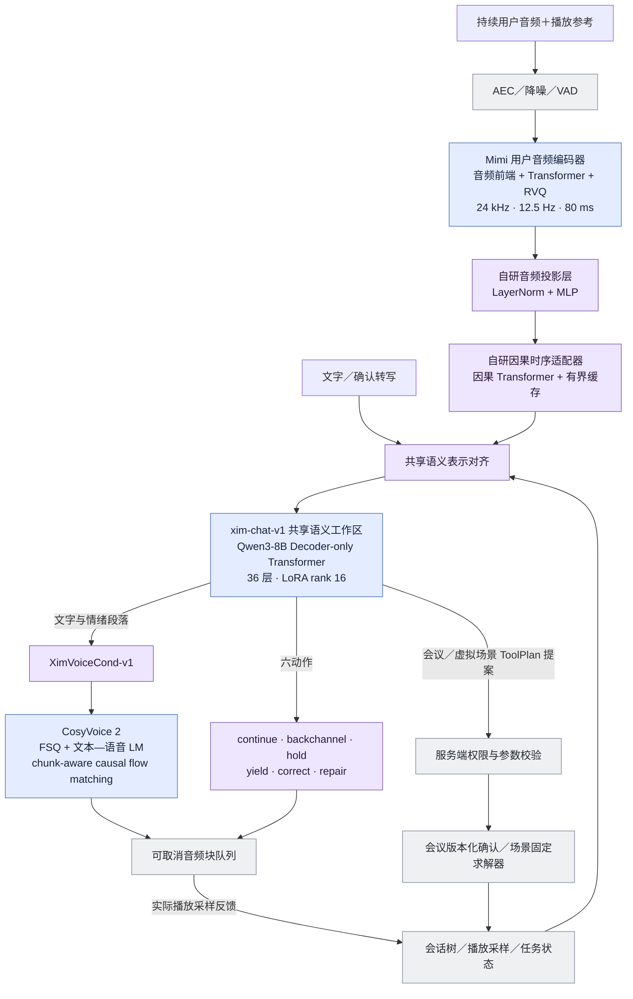
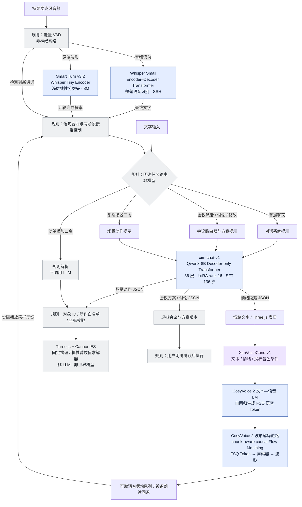

# Xim Duplex · 伴点

一个桌面陪伴机器人原型。Three.js 表情、情绪文字和沉浸式对话舱支持持续收听、插话停播与上下文回答。模型也能接收语音口令，创建虚拟会议，并把明确动作交给受约束的物理工作台执行。


[观看 ChatCut 演示成片](public/media/xim-demo.mp4) · [验证记录](docs/VALIDATION.md)

**[跨模态融合模型 →](docs/FUSION_ARCHITECTURE.md)** · [全链路模型细节](docs/VOICE_TASK_PIPELINE.md) · [当前模型流程与打断续接](docs/MODEL_FLOW.md) · [原生全双工改造方案](docs/DUPLEX_ARCHITECTURE.md)

v0.10.0 新增两阶段插话控制：检测到讲话先暂缓播放，附和或未识别片段可续播，纠正、明确让出与新输入才取消旧回答。新增不含录音和原文的交互验证记录导出；[架构与流程](docs/MODEL_FLOW.md)说明已运行组件和待训练网络的区别。

多任务模型 **[xim-chat-v1](docs/XIM_CHAT_V1_MODEL_CARD.md)** 已完成基于 Qwen3-8B 的 SFT 136 步与 GRPO 120 步。当前采用 SFT 检查点，任务模板留出正确率 94% → 100%；GRPO 奖励组无方差，未证明额外收益。[训练记录与运行方法](training/README.md)保留真实指标和限制。

**自托管产品路线。** 不调用第三方云 API。主对话、[会议空间与物理工作台](docs/WORKBENCH_AND_MEETING.md)共用 Xim 的收音链路；当前这台机器使用服务器 Whisper＋自托管语言模型＋本地神经语音，语音服务不可用时回退设备朗读。创业目标链路采用 Mimi、xim-chat-v1、自研适配模块与 CosyVoice 2。

2026-11-23 组件实测：3.5359 秒固定音频上，Whisper-small 完整转写 P50 894.005 ms；Smart Turn 服务端 P50 32.630 ms；Qwen3-8B＋SFT 非流式完整回复 P50 483.235 ms；CPU 本地 Nano 语音完整 WAV 平均 RTF 0.8195。另在本机 Windows CPU 完成 Mimi 独立编码微基准：3.84 秒合成音频，48×80 ms 编码步，n=10，P50 3793.193 ms、P95 4765.936 ms；这不是服务器、实时、语义、音质或集成结果。样本、逐次结果及限制见[组件实测](docs/evaluations/2026-11-23/README.md)，不能解释为真人端到端或重叠语音指标。[附件改造方案审阅](docs/ARCHITECTURE_REVIEW.md)给出采纳、修改与拒绝项。

## 创业目标：跨模态融合模型

Xim LiveBridge 采用 **Mimi 用户音频编码器＋自研跨模态适配层＋xim-chat-v1＋XimVoiceCond-v1＋CosyVoice 2**。融合是共享语义表示与联合训练，不是把权重直接相加。Mimi 只编码用户音频；自研音频投影与因果时序适配器将语音、文字和会话状态对齐；`xim-chat-v1` 统一生成回复、轮次行为与工具提案；**XimVoiceCond-v1** 再把回复转换为语音条件并驱动 CosyVoice 2 合成声音。**融合权重、XimVoiceCond-v1、CosyVoice 2 部署及完整双工链路目前均为 NOT_TRAINED／NOT_INTEGRATED／NOT_TESTED。** 训练步骤与接口见[融合模型设计](docs/FUSION_ARCHITECTURE.md)。



### 融合模块结构与参数边界

| 模块 | 模型／结构 | 输入 → 输出 | 当前状态 |
| --- | --- | --- | --- |
| Mimi 用户音频编码器 | 音频前端＋Transformer＋RVQ；24 kHz、12.5 Hz、80 ms 帧 | 用户音频 → 帧级音频表示；不使用 Mimi 解码器 | 仅有独立编码微基准；融合接入未测 |
| 自研音频投影层 | LayerNorm＋MLP；维度从实际权重配置读取 | Mimi 表示 → 与语言空间兼容的音频嵌入 | NOT_TRAINED |
| 自研因果时序适配器 | 因果 Transformer＋有界 KV 缓存，只读取过去和当前帧 | 音频嵌入＋转写 revision → 增量语义／韵律特征 | NOT_TRAINED |
| xim-chat-v1 共享语义工作区 | Qwen3-8B 解码器式 Transformer，36 层；冻结基座＋LoRA rank 16；由 SFT 136 步初始化 | 音频／文字／会话／任务状态 → 文字、情绪、轮次语义与 ToolPlan | 文字 SFT 已完成；跨模态融合未训练 |
| 自研轮次行为头 | 共享语义上的六动作分类与校准 | 当前语义＋播放状态 → continue／backchannel／hold／yield／correct／repair | NOT_TRAINED |
| **XimVoiceCond-v1（语音条件对齐模型）** | 语义／文本输入投影＋情绪与授权音色嵌入＋FiLM＋4 层块因果 Transformer（512 维、8 头、RoPE、Pre-LN）＋2 层输出 MLP | 回复语义、文本、情绪、授权音色 → CosyVoice 2 逐块条件序列 | [PyTorch 模块](training/xim_voice_cond.py)已实现；11／11 契约测试通过；NOT_TRAINED |
| CosyVoice 2 | FSQ＋文本—语音 LM＋chunk-aware causal flow matching | 合成条件 → 分块语音候选 | NOT_INTEGRATED／NOT_TESTED |

这里的“融合”是**表示对齐和适配参数联合训练**，不是上游权重直接相加，也不假设 Mimi token 或 Qwen 隐藏状态可以未经投影直接输入 CosyVoice 2。会议版本确认、对象／坐标校验、工具权限和固定物理求解器继续留在模型外。

### P0–P4 联合训练路线（尚未执行）

1. **P0｜基线与数据契约**：固定上游版本、许可与校验值；准备经授权的双通道中文交互数据、转写、六动作、播放边界和工具确认标签。
2. **P1｜音频接入与轮次**：冻结 Mimi 与 Qwen 基座，训练音频投影、因果时序适配器和轮次行为头，优化文字对齐、表示对齐和六动作分类。
3. **P2｜对话与工具联合**：保持基座冻结，联合训练上述适配器和现有 LoRA，覆盖回复、情绪、轮次和受限会议／场景 ToolPlan。
4. **P3｜语音条件训练**：冻结 CosyVoice 2，单独训练 XimVoiceCond-v1；实测首音、RTF、自然度、CER、音色一致性和取消成本。
5. **P4｜受控联合微调与晋级**：仅在独立基线达标后选择性微调适配层或额外 LoRA；通过冻结留出集、真实接口、真人盲评和资源门槛后才晋级。

**当前工程验证（2026-11-24）：65／65 Node 回归通过，XimVoiceCond-v1 11／11 PyTorch 契约测试通过**。前者包含语音创建会议和虚拟场景路由合同；后者覆盖张量形状、块因果、KV 一致性、FiLM、梯度、掩码与失效代次。两类测试都不证明融合模型质量、真人体验或全双工性能。证据边界见[验证记录](docs/VALIDATION.md)，六项未测门槛定义见[融合模型设计](docs/FUSION_ARCHITECTURE.md)；本地 TRL 证据表不随仓库分发。

## 全链路模型：结构、职责与数据流

蓝色节点是神经网络模型，灰色节点是规则、工程控制或数值求解器。**普通聊天、会议规划和复杂场景指令共用同一个 `xim-chat-v1`，不是三个独立语言模型。** 下图把现有语音理解与语言模型、目标语音合成链路放在同一数据流中；CosyVoice 2 和 XimVoiceCond-v1 仍未接入，不能据此宣称融合模型已经运行。



| 图中模型 | 结构 | 在 Xim 中的职责 |
| --- | --- | --- |
| [Whisper Small](https://huggingface.co/Systran/faster-whisper-small) | 音频编码器—文本解码器 Transformer | 把整句语音转成文字；不负责对话或任务决策 |
| [Smart Turn v3.2](https://huggingface.co/pipecat-ai/smart-turn-v3) | Whisper Tiny 编码器＋浅层线性分类头，约 8M 参数 | 直接从波形预测话轮是否完成；不输出转写 |
| [xim-chat-v1](docs/XIM_CHAT_V1_MODEL_CARD.md) | Qwen3-8B 解码器式 Transformer，36 层，冻结基座＋LoRA rank 16，当前使用 SFT 136 步检查点 | 生成聊天情绪段落、会议方案／讨论和结构化场景动作提案 |
| **XimVoiceCond-v1（语音条件对齐模型）** | 输入投影＋情绪／音色／状态嵌入＋FiLM＋4 层块因果 Transformer（512 维、8 头、FFN 2048、RoPE、Pre-LN）＋`512→1024→d_CV2` 输出 MLP | 把共享语义工作区的回复转换为 CosyVoice 2 逐块条件序列；[模块](training/xim_voice_cond.py)与 11 项契约测试已实现，不直接生成音频，尚未训练 |
| [CosyVoice 2](https://github.com/FunAudioLLM/CosyVoice) | FSQ 语音表示＋文本—语音 LM＋chunk-aware causal Flow Matching＋声码器 | 将合成条件转为分块波形；尚未部署或完成 Xim 集成测试 |

能量 VAD、任务路由、会议确认、对象／坐标校验和播放状态机都不是神经网络；Three.js 是渲染引擎，Cannon ES 是刚体物理引擎，机械臂轨迹来自固定数值求解器。当前没有训练物理世界模型，也没有用 LLM 直接计算物理轨迹。

## 当前能力

- 仅调用自托管语言模型，结构化输出异常时回退为可读文字；停止与重试不会追加重复的用户消息。
- 浏览器持续录音 → WebSocket → VAD／Smart Turn → 语音识别 → 两阶段插话控制 → 自托管语言模型或明确任务路由 → 本地神经语音或设备朗读。输出声音时输入保持开启；附和可续播，纠正会取消旧回答；连续语句按序识别，避免被下一句覆盖。
- 语音必须主动点击开启；关闭后立即释放麦克风。无语音服务时仍可打字。可导出仅含事件、相位和相对时间的验证记录，不包含录音或对话原文。
- 六种表情和对应文字色，可关闭颜色与动作。主对话可创建虚拟会议并转发明确的场景口令；模型没有任意工具权限，会议执行、对象 ID、坐标和计算类型均由独立规则校验。
- 自愿提交文字评价，生成可审阅的策略候选；独立真人比较满足门槛后才晋级，并保留旧版本。

这是可插话的级联工程原型，**尚未完成原生端到端双工训练或独立用户对照评测**。两阶段控制目前使用最终转写和规则分类，不能可靠识别所有背景对话、口音与噪声；开放扬声器仍需 AEC，使用耳机更稳。当前仍等待完整文本后开始朗读，神经 TTS 单段生成不可立即中止，但前端可停播并丢弃过期音频。

## 语音创建会议与控制物理场景

在主对话或对应功能页开启语音后，可以直接说：

- 「组织三个人开会，主题是产品演示」：创建 1–8 位虚拟参会者的会议，打开任务卡中的会议空间继续派活、讨论和确认。
- 「添加一个红色方块」：把口令交给物理工作台，在当前浏览器场景中添加物体。
- 「让机械臂抓起小砖」「计算当前场景的下落结果」：工作台根据当前对象与选中状态解析动作，再执行固定轨迹或物理计算。

工作台已打开时通过同源 `BroadcastChannel` 接收口令；未打开时可点击任务入口继续执行。会议不邀请现实人员，物理控制只影响 Three.js／Cannon ES 虚拟场景，不连接实体机械臂。模型输出不会直接变成 shell、Python 或真实硬件命令。完整模型参数、调用预算、数据流、确认机制和目标架构见 **[全链路模型细节](docs/VOICE_TASK_PIPELINE.md)**。

## 启动

需要 Node.js 22+。Windows 本机运行：

```powershell
npm ci
npm start
```

配置 `private/local-models.json` 指向自托管文本服务，或设置 `.env.example` 中的 `XIM_LOCAL_CHAT_URL` 与 `XIM_LOCAL_CHAT_MODEL`。服务需运行在本机回环地址或通过 SSH 转发。访问 http://127.0.0.1:8788 。模型未运行时不会回退到第三方 API。

新安装建议 Python 3.11+；Windows 未配置远程服务时使用已安装的中文听写引擎。当前机器已通过 `private/asr.json` 选择 SSH 连接的服务器识别。建议在 PowerShell 7 的另一个终端启动：

```powershell
./Start_Voice.ps1
```

配置远程识别时，启动脚本检查连接；连接失效会请求 SSH 密码并重建通道，密码不保存到文件。SSH 主机须已在 `known_hosts` 中，脚本不会自动信任新主机。没有远程配置时，兼容路径要求已安装中文听写引擎，服务监听 127.0.0.1:8791。刷新页面，点击「开始语音」，授权麦克风。

远程部署说明见 [识别服务部署](docs/ASR_DEPLOYMENT.md)。`private/`、模型、依赖目录和录音均不进入 GitHub；配置文件只存连接信息，不存密码。远程识别启用时，麦克风音频发送到用户配置的服务器处理。

设置 `$env:ASR_ENGINE='whisper'` 后运行相同脚本，可在支持该依赖的环境安装并使用 faster-whisper。首次安装与下载模型较慢；tiny 是 CPU 起步配置，`ASR_MODEL=small` 可切换模型，GPU 另需匹配 CUDA。该 Windows 机器的应用控制拦截了新装 NumPy 原生组件，因此没有在本机加载它；当前实际 Whisper 推理运行在独立 Linux 服务器。不要关闭系统安全控制来加载组件。

Linux/macOS 可创建虚拟环境、安装 `requirements-asr.txt` 后运行 `python scripts/asr_worker.py`。配置项见 `.env.example`；当前不自动读取 `.env`。

## 改进与评估

```powershell
npm test
npm run test:voice-cond
npm run evolve -- propose data/feedback.jsonl
npm run evolve -- promote path/to/human-evaluation.json
```

候选生成至少需要 10 条已授权负反馈，晋级至少需要 50 条独立真人对照。测试中的合成数据只验证门槛行为，不代表产品已通过真人实验。数据与训练权重不进入 Git。细节、模型组合与官方参考见 [模型方案](docs/MODEL_STRATEGY.md)。

演示视频的镜头、文字和制作状态见 [视频简报](docs/VIDEO_BRIEF.md)。演示用于解释交互，不作为延迟、情绪识别或模型效果的实测证据。

## 数据范围

密钥只保留在服务端。对话默认只在当前页面内存中，服务端为评价暂存最多 100 条回答，刷新/重启不会恢复对话。音频不落盘；勾选授权并点击评价后，对应输入、回答及评价写入本机 `data/feedback.jsonl`。删除该文件可移除反馈记录。

这是个人本地服务，默认仅监听回环地址。公开部署前另需账号隔离、服务端会话、HTTPS、用量控制和部署级隐私设计。

第三方软件和模型说明见 [THIRD_PARTY.md](THIRD_PARTY.md)。
