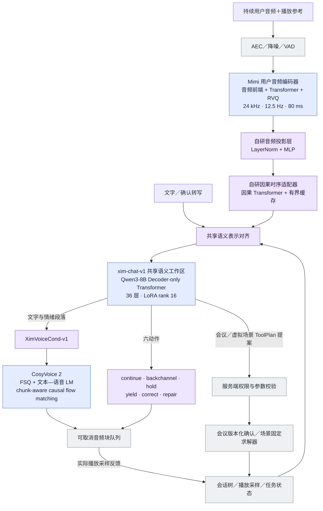
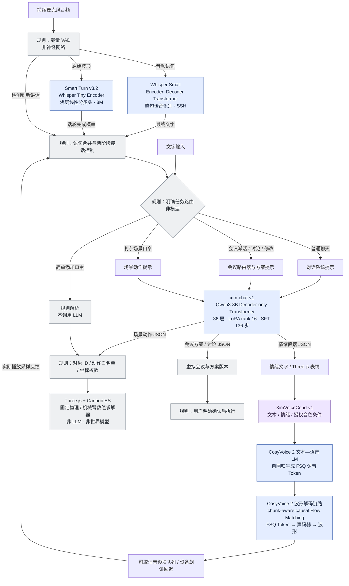

# Xim Duplex · 伴点

一个桌面陪伴机器人原型。Three.js 表情、情绪文字和沉浸式对话舱支持持续收听、插话停播与上下文回答。模型也能接收语音口令，创建虚拟会议，并把明确动作交给受约束的物理工作台执行。


[观看 ChatCut 演示成片](public/media/xim-demo.mp4) · [验证记录](docs/VALIDATION.md)

**[跨模态融合模型 →](docs/FUSION_ARCHITECTURE.md)** · [全链路模型细节](docs/VOICE_TASK_PIPELINE.md) · [当前模型流程与打断续接](docs/MODEL_FLOW.md) · [原生全双工改造方案](docs/DUPLEX_ARCHITECTURE.md)

v0.10.0 新增两阶段插话控制：检测到讲话先暂缓播放，附和或未识别片段可续播，纠正、明确让出与新输入才取消旧回答。新增不含录音和原文的交互验证记录导出；[架构与流程](docs/MODEL_FLOW.md)说明已运行组件和待训练网络的区别。

多任务模型 **[xim-chat-v1](docs/XIM_CHAT_V1_MODEL_CARD.md)** 已完成基于 Qwen3-8B 的 SFT 136 步与 GRPO 120 步。当前采用 SFT 检查点，任务模板留出正确率 94% → 100%；GRPO 奖励组无方差，未证明额外收益。[训练记录与运行方法](training/README.md)保留真实指标和限制。

**自托管产品路线。** 不调用第三方云 API。主对话、[会议空间与物理工作台](docs/WORKBENCH_AND_MEETING.md)共用 Xim 的收音链路；当前这台机器使用服务器 Whisper＋自托管语言模型＋本地神经语音，语音服务不可用时回退设备朗读。创业目标链路采用 Mimi、xim-chat-v1、自研适配模块与 CosyVoice 2。

2026-11-23 组件实测：3.5359 秒固定音频上，Whisper-small 完整转写 P50 894.005 ms；Smart Turn 服务端 P50 32.630 ms；Qwen3-8B＋SFT 非流式完整回复 P50 483.235 ms；CPU 本地 Nano 语音完整 WAV 平均 RTF 0.8195。另在本机 Windows CPU 完成 Mimi 独立编码微基准：3.84 秒合成音频，48×80 ms 编码步，n=10，P50 3793.193 ms、P95 4765.936 ms；这不是服务器、实时、语义、音质或集成结果。样本、逐次结果及限制见[组件实测](docs/evaluations/2026-11-23/README.md)，不能解释为真人端到端或重叠语音指标。[附件改造方案审阅](docs/ARCHITECTURE_REVIEW.md)给出采纳、修改与拒绝项。

## 创业目标：跨模态融合模型

Xim LiveBridge 采用 **Mimi 用户音频编码器＋自研跨模态适配层＋xim-chat-v1＋XimVoiceCond-v1＋CosyVoice 2**。融合是共享语义表示与联合训练，不是把权重直接相加。Mimi 只编码用户音频；自研音频投影与因果时序适配器将语音、文字和会话状态对齐；`xim-chat-v1` 统一生成回复、轮次行为与工具提案；**XimVoiceCond-v1** 再把回复转换为语音条件并驱动 CosyVoice 2 合成声音。**融合权重、XimVoiceCond-v1、CosyVoice 2 部署及完整双工链路目前均为 NOT_TRAINED／NOT_INTEGRATED／NOT_TESTED。** 训练步骤与接口见[融合模型设计](docs/FUSION_ARCHITECTURE.md)。



### 融合模块结构与参数边界

| 模块 | 模型／结构 | 输入 → 输出 | 当前状态 |
| --- | --- | --- | --- |
| Mimi 用户音频编码器 | 音频前端＋Transformer＋RVQ；24 kHz、12.5 Hz、80 ms 帧 | 用户音频 → 帧级音频表示；不使用 Mimi 解码器 | 仅有独立编码微基准；融合接入未测 |
| 自研音频投影层 | LayerNorm＋MLP；维度从实际权重配置读取 | Mimi 表示 → 与语言空间兼容的音频嵌入 | NOT_TRAINED |
| 自研因果时序适配器 | 因果 Transformer＋有界 KV 缓存，只读取过去和当前帧 | 音频嵌入＋转写 revision → 增量语义／韵律特征 | NOT_TRAINED |
| xim-chat-v1 共享语义工作区 | Qwen3-8B 解码器式 Transformer，36 层；冻结基座＋LoRA rank 16；由 SFT 136 步初始化 | 音频／文字／会话／任务状态 → 文字、情绪、轮次语义与 ToolPlan | 文字 SFT 已完成；跨模态融合未训练 |
| 自研轮次行为头 | 共享语义上的六动作分类与校准 | 当前语义＋播放状态 → continue／backchannel／hold／yield／correct／repair | NOT_TRAINED |
| **XimVoiceCond-v1（语音条件对齐模型）** | 语义／文本输入投影＋情绪与授权音色嵌入＋FiLM＋4 层块因果 Transformer（512 维、8 头、RoPE、Pre-LN）＋2 层输出 MLP | 回复语义、文本、情绪、授权音色 → CosyVoice 2 逐块条件序列 | [PyTorch 模块](training/xim_voice_cond.py)已实现；11／11 契约测试通过；NOT_TRAINED |
| CosyVoice 2 | FSQ＋文本—语音 LM＋chunk-aware causal flow matching | 合成条件 → 分块语音候选 | [896 维条件适配层](training/xim_cosyvoice2_bridge.py)与 9／9 接口兼容 dry-run 已实现；官方权重 NOT_INTEGRATED／NOT_TESTED |

这里的“融合”是**表示对齐和适配参数联合训练**，不是上游权重直接相加，也不假设 Mimi token 或 Qwen 隐藏状态可以未经投影直接输入 CosyVoice 2。适配层只对目标文本嵌入加入零初始化门控残差，保留提示文本、任务标记、提示语音和官方序列顺序。会议版本确认、对象／坐标校验、工具权限和固定物理求解器继续留在模型外。

### 全链路推理公式

以下分成 **A．当前可运行级联**、**B．已经实现的语音条件张量计算**、**C．尚未接入的目标融合链路**。A 是现有产品服务的推理过程；B 已通过合成张量契约测试，但使用随机初始化模块；C 只有目标公式，不能当成真实端到端结果。

#### A．当前可运行级联：音频 → 文字／任务 → 播放

1. **PCM 归一化与能量 VAD**：浏览器以 16 kHz、单声道 PCM16 采集音频，每 50 ms 一帧，即 `N=800` 个采样点。对原始整数采样 `x_raw[n]` 和归一化采样 `x[n]`，代码计算：

   ```text
   x[n]  = x_raw[n] / 32768
   RMS_t = sqrt((1/N) · Σ_(n=1..N) x_t[n]²)
   ```

   `RMS_t ≥ 0.012` 累计 160 ms 后启动语句；启动后 `RMS_t < 0.8×0.012` 累计 700 ms，或语句达到 14 秒，则结束并提交。此处是确定性状态机，不是神经网络。

2. **Smart Turn 话尾概率**：服务截取最后 `128000` 个采样点（8 秒），不足时左侧补零，再经过 Whisper 特征提取器和已导出的 ONNX 分类模型。

   ```text
   x_8s      = LeftPadOrLastN(x, 128000)
   F_turn    = WhisperFeatureExtractor(x_8s)
   p_complete = TurnONNX(F_turn)                    # 标量，范围 [0,1]
   complete  = (p_complete > 0.5)
   ```

   它只预测声学话轮是否完成，不生成转写；失败时回退到既有 VAD 语句边界。

3. **Whisper Small 语音识别**：对 VAD 给出的完整语句 `x_utt`，音频编码器产生隐藏表示，文本解码器自回归计算 Token 条件分布。用 `Decode` 表示服务实际采用的解码过程，而不把它简化成已证实的贪心搜索。

   ```text
   H_audio = WhisperEncoder(x_utt)
   p(y_i | x_utt,y_<i) = WhisperDecoder(y_<i,H_audio)
   y = Decode_whisper(Π_i p(y_i | x_utt,y_<i))
   ```

   输出 `y` 是整句文字。当前没有从该模块得到流式字词时间戳或端到端语义工具权限。

4. **会话状态、双工门控与任务路由**：已确认转写、历史、实际播放前缀和当前输出代次组成有界状态 `S_t`；话尾概率、插话类别和播放相位经确定性门控得到 `g_t`。

   ```text
   S_t = BoundedHistory(y_≤t, playback_ack_≤t, generation_id, task_state)
   g_t = Gate(p_complete, interruption_intent, playback_phase)
       ∈ {continue, hold, resume, cancel}
   r_t = RouteVoiceTask(y_t,S_t)
       ∈ {chat, meeting, workbench, simple_action}
   ```

   `cancel` 使未播放的旧代音频失效；只有实际播放确认的前缀进入共享历史。路由函数是规则，不是另一个语言模型。

5. **xim-chat-v1 自回归语言推理**：普通聊天、会议和复杂场景提示分别构造 Token 序列，但共用 Qwen3-8B 的 36 层解码器。对任一 Transformer 层，标准计算可写为：

   ```text
   Q = RoPE(H·W_Q)，K = RoPE(H·W_K)，V = H·W_V
   Attn(H) = softmax(Q·Kᵀ/√d_k + M_causal)·V
   H'      = H + Attn(LN(H))
   H_next  = H' + FFN(LN(H'))
   p(z_i | z_<i) = softmax(W_U·H_36)
   ```

   当前 SFT 适配器在 `q_proj、v_proj` 上使用 LoRA rank `r=16`、alpha `32`，对应缩放 `α/r=2`。对其中一个被适配投影，推理时冻结基座并加上低秩增量：

   ```text
   W_eff = W_frozen + (α/r)·B·A
   H_out = H·W_eff
   ```

   主聊天按 `temperature=0.65` 从上述条件分布采样，`max_tokens=320`、非流式；会议和工作台分别使用各自的 JSON 提示及 Token 上限。文本解析与权限校验在模型外执行：

   ```text
   J = ParseAndValidate(z_1:T)
   chat: J = {segments[{text,emotion}]}，最多 6 段、总计不超过 1600 字
   task: J → SchemaCheck → AllowlistCheck → Confirmation（适用时）
   ```

   模型自由生成的 `tool_calls`、shell、URL 或未列出动作不会因此获得执行权限。

6. **当前语音输出与播放反馈**：每个已校验文字段连同允许的情绪标签交给当前本地神经语音接口，返回有界 WAV；失败时才使用设备朗读回退。

   ```text
   wav_k = LocalTTS(text_k,voice,emotion_k)          # 当前级联，非下方目标适配链
   a_k[n] = DecodeWAV(wav_k)
   N_ack,k = ActualPlayedSamples(a_k,stop_or_cancel_time)
   S_t+1 = AcknowledgeOnlyPlayedPrefix(S_t,N_ack,k)
   ```

   WAV 接口限制为 4,000,000 字节。播放确认依据真实已播放采样，而不是 UI 动画；前端停播不等于神经网络生成已经即时中止。

7. **会议与虚拟物理场景的执行计算**：模型只提出候选 `a_t`，服务端结合当前场景／会议版本校验后执行。

   ```text
   a_valid = ValidateAction(a_t,current_objects,allowed_actions,coordinate_bounds)
   result  = Execute(a_valid,confirmed_version)
   S_scene,t+1 = ThreeJS_CannonES(S_scene,t,a_valid)
   q_target = ThreeJointIK(position_target)
   trajectory = SmoothSample(q_start,q_target,37)
   ```

   自由落体开发计算忽略空气阻力：`t_hit=sqrt(2h/g)`、`v_hit=g·t_hit`。Three.js、Cannon ES 和逆运动学求解器都不是 LLM；这里只影响浏览器虚拟场景，不控制实体机械臂。

#### B．语音条件张量计算：语义 → 896 维条件 → 上游输入

本部分对应已经实现的 [XimVoiceCond-v1](training/xim_voice_cond.py) 和 [CosyVoice 2 条件适配层](training/xim_cosyvoice2_bridge.py)。**当前计算入口是调用方提供的语义张量，不是已经接通的 Mimi／xim-chat-v1 隐藏状态。** 契约测试使用随机初始化的模块和合成张量；下列公式说明代码怎样计算，不代表语音训练或官方权重推理已经完成。

设批大小为 `B`、文本 Token 数为 `T`。默认语义输入为 `X ∈ R[B,T,4096]`，情绪、授权音色和状态 ID 分别为 `e、s、u ∈ Z[B]`，每个 Token 的单调非减块号为 `chunk_id ∈ Z[B,T]`。

1. **语义输入投影**：先线性映射到 512 维，再做 LayerNorm。

   ```text
   H0 = LayerNorm(Linear_4096→512(X))                  # [B,T,512]
   c  = concat(E_emotion(e), E_speaker(s), E_state(u)) # [B,256]
   ```

   三类嵌入分别为 64、128、64 维，拼接后的条件向量 `c` 为 256 维。

2. **四层块因果 Transformer**：第 `l` 层先对 `H_l` 做 Pre-LN、RoPE 多头注意力和输出投影得到 `A_l`，再将该层的 FiLM 参数作用于注意力结果。可见性由 `chunk_id` 和布尔掩码共同决定。

   ```text
   A_l    = MHA_RoPE(LN1(H_l), past_KV, block_causal_mask)
   allow(i,j) = (chunk_id[j] <= chunk_id[i]) AND key_padding_mask[j]
   H_l'   = H_l + Dropout(A_l * (1 + scale_l(c)) + shift_l(c))
   H_l+1  = H_l' + Dropout(FFN_512→2048→512(LN2(H_l')))
   ```

   8 个注意力头各自处理 64 维。当前块内部可以双向注意，跨块只能读取当前及过去块。增量计算把每层的 K、V、块号和位置写入缓存；每次调用必须给出完整且严格更新的块，累计长度不得超过 256 Token。

3. **语音条件与辅助韵律输出**：对最后一层隐藏状态 `H` 同时计算残差分支和两层 MLP 分支，归一化后产生 896 维条件；独立预测头输出三个辅助值。无效填充位置最后乘以零掩码。

   ```text
   C = LayerNorm(Linear_512→896(H) + MLP_512→1024→896(H)) * attention_mask
   P = MLP_512→256→3(H)                                      * attention_mask
   # C: [B,T,896]；P: [B,T,3]，依次对应时长／基频／能量辅助预测
   ```

   `P` 是训练监督候选，不是已接入合成器的三个实时控制参数。跨代输出还需经过 `pack_condition_chunk`：只有 `generation_id` 等于当前代次的块才会保留。

4. **目标文本嵌入的条件残差**：进入上游适配层时使用 batch 1。文本 Embedding 分别计算提示文本 `P_text` 和目标文本 `T_text`，条件 `C` 经 LayerNorm、`tanh` 和可训练标量门控 `α` 后只加到目标文本上。

   ```text
   P_text = Embed_text(prompt_text)                    # [1,Tp,896]
   T_text = Embed_text(text)                           # [1,T,896]
   R      = tanh(LayerNorm(C)) * condition_mask         # [1,T,896]
   T_cond = T_text + α · R                             # [1,T,896]
   ```

   `α` 初始化为 0，所以未训练时严格有 `T_cond = T_text`。测试显式设置非零 `α`，确认只有目标文本区间发生变化。

5. **构造上游语言模型输入**：从官方属性链读取 `sos`、`task_id` 和提示语音 Embedding，保持官方非流式拼接顺序。

   ```text
   S_prompt = Embed_speech(prompt_speech_token)         # [1,Ts,896]
   lm_input = concat(sos, P_text, T_cond, task_id, S_prompt, dim=1)
   L        = 1 + Tp + T + 1 + Ts
   # lm_input: [1,L,896]；提示文本、任务标记和提示语音均未加条件残差
   ```

6. **计算有界生成预算并调用上游入口**：默认 `sampling=25`、`min_token_text_ratio=2`、`max_token_text_ratio=20`。代码先按文本长度计算上下限，再应用可选的硬上限。

   ```text
   min_len = int(T * min_token_text_ratio)
   max_len = int(T * max_token_text_ratio)
   max_len = max(1, min(max_len, max_tokens))  # 仅在提供 max_tokens 时取 min
   min_len = min(min_len, max_len)
   tokens  = inference_wrapper(lm_input, sampling, min_len, max_len, uuid)
   ```

   官方入口按 batch 1 顺序处理样本。当前 dry-run 的接口替身只返回确定性的有界整数序列，用于检查调用和张量契约；**这些整数不是经官方 CosyVoice 2 权重生成并验收的 FSQ 语音 Token**。后续 Flow Matching、声码器、波形、首音、RTF、自然度和取消成本均不在本轮 dry-run 的计算范围内。

#### C．目标融合链路：持续音频 → 共享语义 → 自回归语音 Token → 波形

以下是目标模型的推理公式，**尚未完成跨模态训练或真实集成**，不能与前两节的现有代码证据混合计算延迟或效果。

1. **Mimi 音频表示与共享语义对齐**：目标输入重采样到 24 kHz，经 Mimi 音频前端、Transformer 和 RVQ 得到带时间戳的音频表示；自研投影和因果时序适配器再将它与文字、播放及任务状态对齐。

   ```text
   Z_audio = MimiEncoder_RVQ(Resample(x,24000))       # 12.5 Hz，80 ms／帧
   A_t = TemporalAdapter(MLP(LayerNorm(Z_audio≤t)),
                         EmbedText(y≤t),S_t,past_KV)
   H_t = XimChatSharedWorkspace(A_t,text_tokens,S_t)
   ```

   `TemporalAdapter` 只读取当前和过去音频。当前尚未实现从 Mimi 到 xim-chat-v1 的可训练投影检查点，也没有把 `H_t` 自动送入 B 部分。

2. **共享语义的语言、轮次、工具与语音条件分支**：同一个语义工作区分别产生回复 Token、六动作轮次分布、受限任务提案，以及 B 部分所需的语义输入。

   ```text
   z_reply ~ p_xim-chat(z_reply | H_t)
   p_turn  = softmax(W_turn·H_t + b_turn)              # 六动作，NOT_TRAINED
   a_plan  = ParseAndValidate(z_reply)                   # 仍需外部权限校验
   C = XimVoiceCondV1(X_semantic,e,s,u,chunk_ids)        # B 部分，[1,T,896]
   ```

3. **CosyVoice 2 自回归语音 Token 推理**：将 `C` 按 B 部分注入目标文本 Embedding，形成 `lm_input`，上游文本—语音 LM 逐 Token 计算条件分布。

   ```text
   lm_input = BuildLMInput(sos,prompt_text,T_cond,task_id,prompt_speech)
   p(q_i | q_<i,lm_input) = softmax(Qwen2LM(lm_input,q_<i))
   q_1:K = BoundedAutoregressiveDecode(p,min_len,max_len,sampling)
   ```

   `q_1:K` 是目标 FSQ 语音 Token 序列。当前只验证了入口签名、形状和预算，没有加载官方权重计算这个条件分布。

4. **Flow Matching 与声码器波形解码**：目标链路用语音 Token 及上游声学条件约束速度场，沿连续时间变量 `τ` 对潜在表示积分，再由上游声码器得到波形。下面用通用 ODE 形式表示，具体条件、采样器和边界以固定上游实现为准。

   ```text
   dz/dτ = v_flow(z,τ | q_1:K,acoustic_context)
   z_speech = ODESolve(v_flow,z_initial,τ_start→τ_end)
   a[n] = Vocoder(z_speech)[n]
   ```

   目标产品闭环因此可概括为：

   ```text
   x → Mimi／投影／时序适配 → H_t → xim-chat-v1
                                  ├→ 回复／轮次／受限任务
                                  └→ XimVoiceCond-v1 → 文本嵌入残差
                                     → CosyVoice 2 AR Token
                                     → Flow Matching → Vocoder → a[n]
   a[n] → 实际播放采样反馈 → S_t+1 → 下一轮持续输入
   ```

   **C 部分没有真实推理结果**：尚未测量这条链路的真实语音 Token 质量、波形、首音、RTF、自然度、CER、音色一致性、AEC 或真人全双工指标。

### P0–P4 联合训练路线（尚未执行）

1. **P0｜基线与数据契约**：固定上游版本、许可与校验值；准备经授权的双通道中文交互数据、转写、六动作、播放边界和工具确认标签。
2. **P1｜音频接入与轮次**：冻结 Mimi 与 Qwen 基座，训练音频投影、因果时序适配器和轮次行为头，优化文字对齐、表示对齐和六动作分类。
3. **P2｜对话与工具联合**：保持基座冻结，联合训练上述适配器和现有 LoRA，覆盖回复、情绪、轮次和受限会议／场景 ToolPlan。
4. **P3｜语音条件训练**：冻结 CosyVoice 2，单独训练 XimVoiceCond-v1；实测首音、RTF、自然度、CER、音色一致性和取消成本。
5. **P4｜受控联合微调与晋级**：仅在独立基线达标后选择性微调适配层或额外 LoRA；通过冻结留出集、真实接口、真人盲评和资源门槛后才晋级。

**当前工程验证（2026-11-24）：65／65 Node 回归、XimVoiceCond-v1 11／11 PyTorch 契约测试、CosyVoice 2 适配层 9／9 接口兼容测试通过**。Node 测试包含语音创建会议和虚拟场景路由合同；语音条件测试覆盖张量形状、块因果、KV 一致性、FiLM、梯度、掩码与失效代次；适配测试使用接口替身顺序运行两个 batch-1 样本。三类测试都不证明官方权重推理、融合模型质量、真人体验或全双工性能。证据边界见[验证记录](docs/VALIDATION.md)，六项未测门槛定义见[融合模型设计](docs/FUSION_ARCHITECTURE.md)；本地 TRL 证据表不随仓库分发。

## 全链路模型：结构、职责与数据流

蓝色节点是神经网络模型，灰色节点是规则、工程控制或数值求解器。**普通聊天、会议规划和复杂场景指令共用同一个 `xim-chat-v1`，不是三个独立语言模型。** 下图把现有语音理解与语言模型、目标语音合成链路放在同一数据流中；CosyVoice 2 和 XimVoiceCond-v1 仍未接入，不能据此宣称融合模型已经运行。



| 图中模型 | 结构 | 在 Xim 中的职责 |
| --- | --- | --- |
| [Whisper Small](https://huggingface.co/Systran/faster-whisper-small) | 音频编码器—文本解码器 Transformer | 把整句语音转成文字；不负责对话或任务决策 |
| [Smart Turn v3.2](https://huggingface.co/pipecat-ai/smart-turn-v3) | Whisper Tiny 编码器＋浅层线性分类头，约 8M 参数 | 直接从波形预测话轮是否完成；不输出转写 |
| [xim-chat-v1](docs/XIM_CHAT_V1_MODEL_CARD.md) | Qwen3-8B 解码器式 Transformer，36 层，冻结基座＋LoRA rank 16，当前使用 SFT 136 步检查点 | 生成聊天情绪段落、会议方案／讨论和结构化场景动作提案 |
| **XimVoiceCond-v1（语音条件对齐模型）** | 输入投影＋情绪／音色／状态嵌入＋FiLM＋4 层块因果 Transformer（512 维、8 头、FFN 2048、RoPE、Pre-LN）＋`512→1024→d_CV2` 输出 MLP | 把共享语义工作区的回复转换为 CosyVoice 2 逐块条件序列；[模块](training/xim_voice_cond.py)与 11 项契约测试已实现，不直接生成音频，尚未训练 |
| [CosyVoice 2](https://github.com/FunAudioLLM/CosyVoice) | FSQ 语音表示＋文本—语音 LM＋chunk-aware causal Flow Matching＋声码器 | 将合成条件转为分块波形；尚未部署或完成 Xim 集成测试 |

能量 VAD、任务路由、会议确认、对象／坐标校验和播放状态机都不是神经网络；Three.js 是渲染引擎，Cannon ES 是刚体物理引擎，机械臂轨迹来自固定数值求解器。当前没有训练物理世界模型，也没有用 LLM 直接计算物理轨迹。

## 当前能力

- 仅调用自托管语言模型，结构化输出异常时回退为可读文字；停止与重试不会追加重复的用户消息。
- 浏览器持续录音 → WebSocket → VAD／Smart Turn → 语音识别 → 两阶段插话控制 → 自托管语言模型或明确任务路由 → 本地神经语音或设备朗读。输出声音时输入保持开启；附和可续播，纠正会取消旧回答；连续语句按序识别，避免被下一句覆盖。
- 语音必须主动点击开启；关闭后立即释放麦克风。无语音服务时仍可打字。可导出仅含事件、相位和相对时间的验证记录，不包含录音或对话原文。
- 六种表情和对应文字色，可关闭颜色与动作。主对话可创建虚拟会议并转发明确的场景口令；模型没有任意工具权限，会议执行、对象 ID、坐标和计算类型均由独立规则校验。
- 自愿提交文字评价，生成可审阅的策略候选；独立真人比较满足门槛后才晋级，并保留旧版本。

这是可插话的级联工程原型，**尚未完成原生端到端双工训练或独立用户对照评测**。两阶段控制目前使用最终转写和规则分类，不能可靠识别所有背景对话、口音与噪声；开放扬声器仍需 AEC，使用耳机更稳。当前仍等待完整文本后开始朗读，神经 TTS 单段生成不可立即中止，但前端可停播并丢弃过期音频。

## 语音创建会议与控制物理场景

在主对话或对应功能页开启语音后，可以直接说：

- 「组织三个人开会，主题是产品演示」：创建 1–8 位虚拟参会者的会议，打开任务卡中的会议空间继续派活、讨论和确认。
- 「添加一个红色方块」：把口令交给物理工作台，在当前浏览器场景中添加物体。
- 「让机械臂抓起小砖」「计算当前场景的下落结果」：工作台根据当前对象与选中状态解析动作，再执行固定轨迹或物理计算。

工作台已打开时通过同源 `BroadcastChannel` 接收口令；未打开时可点击任务入口继续执行。会议不邀请现实人员，物理控制只影响 Three.js／Cannon ES 虚拟场景，不连接实体机械臂。模型输出不会直接变成 shell、Python 或真实硬件命令。完整模型参数、调用预算、数据流、确认机制和目标架构见 **[全链路模型细节](docs/VOICE_TASK_PIPELINE.md)**。

## 启动

需要 Node.js 22+。Windows 本机运行：

```powershell
npm ci
npm start
```

配置 `private/local-models.json` 指向自托管文本服务，或设置 `.env.example` 中的 `XIM_LOCAL_CHAT_URL` 与 `XIM_LOCAL_CHAT_MODEL`。服务需运行在本机回环地址或通过 SSH 转发。访问 http://127.0.0.1:8788 。模型未运行时不会回退到第三方 API。

新安装建议 Python 3.11+；Windows 未配置远程服务时使用已安装的中文听写引擎。当前机器已通过 `private/asr.json` 选择 SSH 连接的服务器识别。建议在 PowerShell 7 的另一个终端启动：

```powershell
./Start_Voice.ps1
```

配置远程识别时，启动脚本检查连接；连接失效会请求 SSH 密码并重建通道，密码不保存到文件。SSH 主机须已在 `known_hosts` 中，脚本不会自动信任新主机。没有远程配置时，兼容路径要求已安装中文听写引擎，服务监听 127.0.0.1:8791。刷新页面，点击「开始语音」，授权麦克风。

远程部署说明见 [识别服务部署](docs/ASR_DEPLOYMENT.md)。`private/`、模型、依赖目录和录音均不进入 GitHub；配置文件只存连接信息，不存密码。远程识别启用时，麦克风音频发送到用户配置的服务器处理。

设置 `$env:ASR_ENGINE='whisper'` 后运行相同脚本，可在支持该依赖的环境安装并使用 faster-whisper。首次安装与下载模型较慢；tiny 是 CPU 起步配置，`ASR_MODEL=small` 可切换模型，GPU 另需匹配 CUDA。该 Windows 机器的应用控制拦截了新装 NumPy 原生组件，因此没有在本机加载它；当前实际 Whisper 推理运行在独立 Linux 服务器。不要关闭系统安全控制来加载组件。

Linux/macOS 可创建虚拟环境、安装 `requirements-asr.txt` 后运行 `python scripts/asr_worker.py`。配置项见 `.env.example`；当前不自动读取 `.env`。

## 改进与评估

```powershell
npm test
npm run test:voice-cond
npm run test:cosyvoice2-bridge
npm run evolve -- propose data/feedback.jsonl
npm run evolve -- promote path/to/human-evaluation.json
```

候选生成至少需要 10 条已授权负反馈，晋级至少需要 50 条独立真人对照。测试中的合成数据只验证门槛行为，不代表产品已通过真人实验。数据与训练权重不进入 Git。细节、模型组合与官方参考见 [模型方案](docs/MODEL_STRATEGY.md)。

演示视频的镜头、文字和制作状态见 [视频简报](docs/VIDEO_BRIEF.md)。演示用于解释交互，不作为延迟、情绪识别或模型效果的实测证据。

## 数据范围

密钥只保留在服务端。对话默认只在当前页面内存中，服务端为评价暂存最多 100 条回答，刷新/重启不会恢复对话。音频不落盘；勾选授权并点击评价后，对应输入、回答及评价写入本机 `data/feedback.jsonl`。删除该文件可移除反馈记录。

这是个人本地服务，默认仅监听回环地址。公开部署前另需账号隔离、服务端会话、HTTPS、用量控制和部署级隐私设计。

第三方软件和模型说明见 [THIRD_PARTY.md](THIRD_PARTY.md)。
