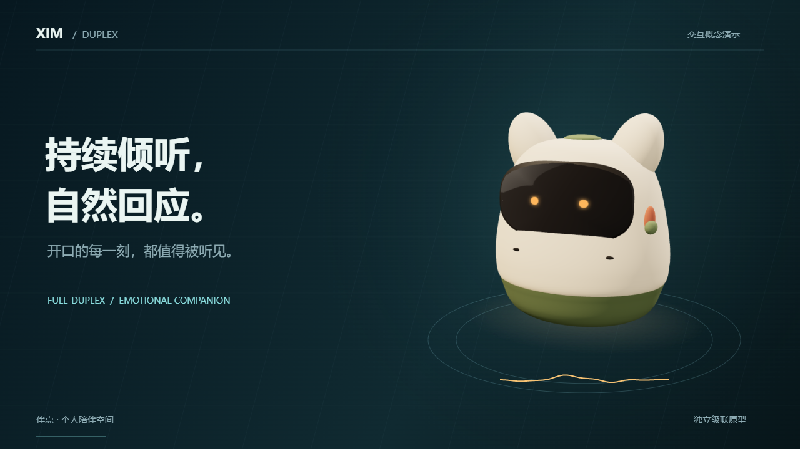
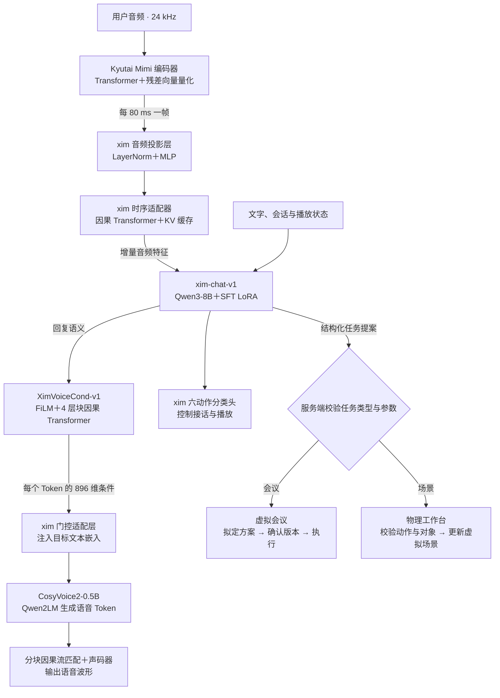

# Xim Duplex · 伴点

伴点是一个自托管的桌面陪伴机器人原型。它在朗读时继续收音：听到新讲话就暂停，听清「嗯嗯」可以续播，听到纠正则取消旧回复。主对话也能创建虚拟会议，或把「添加一个红色方块」交给浏览器里的物理工作台。



[观看演示](public/media/xim-demo.mp4) · [验证记录](docs/VALIDATION.md) · [全链路推理公式](docs/INFERENCE.md)

## 本地启动

### 测试小模型（Windows CPU）

安装 Node.js 22+ 和 Python 3.11+，在项目目录运行以下命令。首次启动会安装依赖并下载 Whisper Tiny 和 Qwen2.5-0.5B-Instruct 的 INT8 权重，后续复用本机缓存。语音识别与回复都在本机运行，朗读使用浏览器的设备语音。

```powershell
./Start_Xim.ps1 -SmallModel
```

看到 `Ready` 后打开 [小模型测试页](http://127.0.0.1:8790)，点击「实时语音」并允许麦克风。说「你好，今天心情很好」测试对话。说「组织三个人开会，主题是产品演示」或「请创建一个红色方块」，再点击回复中的链接进入对应空间。也可以在输入框键入同样的指令。会议页和工作台也可直接开启语音。按 Ctrl+C 关闭本次测试服务。推理引擎为 CTranslate2。[语音识别权重](https://huggingface.co/Systran/faster-whisper-tiny) · [对话模型及量化来源](https://huggingface.co/jncraton/Qwen2.5-0.5B-Instruct-ct2-int8)

### 使用已有自托管服务

先在终端设置 `XIM_LOCAL_CHAT_URL` 和 `XIM_LOCAL_CHAT_MODEL`，分别指向本机或经 SSH 转发的自托管文本服务及其模型名。也可写入 `private/local-models.json` 的 `chat_url`、`chat_model` 字段。配置示例见 [.env.example](.env.example)，启动脚本读取进程环境变量。

```powershell
npm ci
npm start
```

打开 [本机对话页](http://127.0.0.1:8788)。仅启动 Node 服务即可浏览界面，生成回答还需文本模型就绪。

要启用麦克风，在另一个 PowerShell 终端运行 `./Start_Voice.ps1`，刷新页面并点击「实时语音」授权。Windows 默认使用已安装的中文听写引擎，也支持 Whisper 或经 SSH 转发的识别服务。远程识别会将语句音频发送至配置的服务器。可选的 Smart Turn 和语音合成服务分别由 `XIM_TURN_URL` 和 `XIM_LOCAL_TTS_*` 配置。[语音部署指南](docs/ASR_DEPLOYMENT.md)

## LiveBridge 目标模型流程

LiveBridge 计划复用 xim-chat-v1 的文本检查点，让它同时读取用户的语音特征、文字和会话状态。图中从音频编码到语音合成的完整链路仍待联合训练和集成。[融合架构与训练路线](docs/FUSION_ARCHITECTURE.md)



### xim 六动作分类头

分类头的目标是决定伴点何时听、何时说。它读取会话与播放状态，输出以下六类动作。当前小模型演示通过 VAD、最终转写和规则处理插话；学习式分类头仍待训练。

| 动作 | 何时使用 | 伴点的行为 |
| --- | --- | --- |
| `continue` 继续 | 对话按原意进行，用户示意「接着说」 | 继续当前回答，从已确认的播放位置衔接 |
| `backchannel` 附和 | 用户仍在讲述，只需要一个简短回应 | 在合适间隙给出「嗯」等短反馈，把话轮留给用户 |
| `hold` 暂缓 | 出现短停顿或刚检测到声音，意图仍不明确 | 暂缓输出，等待后续语音，在等待上限内重新判断 |
| `yield` 让话 | 用户明确说「等一下，让我说」 | 停止当前回答的播放，继续收听用户 |
| `correct` 纠正 | 用户替换上一轮信息，例如「不是周三，是周四」 | 接受新信息，取消过期回复，按修正后的上下文作答 |
| `repair` 澄清 | 重叠语音或指代不清，无法确定用户的意思 | 询问「你指哪一个方块？」等具体问题，等确认后再继续 |

会议和场景指令由独立的任务路由处理。虚拟会议保存参会者、方案和确认版本；物理工作台根据当前选中对象与坐标校验动作，再交给浏览器里的刚体引擎或轨迹求解器。[会议与工作台](docs/WORKBENCH_AND_MEETING.md)

### 模型与验证进度

| 模块 | 怎么搭建、验证到了哪一步 |
| --- | --- |
| Mimi 与输入适配器 | Mimi 将音频编码为每秒 12.5 帧的表示，已有独立编码微基准。计划用 MLP 把帧映射到语言模型的嵌入空间，再由只读取当前及过去帧的 Transformer 对齐语音与文字。音频适配器和六动作分类头待训练。[编码实测](docs/evaluations/2026-11-23/README.md) |
| xim-chat-v1 | 语言侧采用 136 步监督微调（SFT）的检查点。100 条合成任务留出样本的正确率从 94% 升至 100%，后续 120 步 GRPO 未显示额外收益。音频输入和任务提案的联合训练仍在计划中。[训练与评测](docs/XIM_CHAT_V1_MODEL_CARD.md) |
| XimVoiceCond-v1 | 已实现的 PyTorch 模块接收语义张量、情绪、授权音色和状态 ID，用 FiLM 调制四层 512 维、8 头的 Transformer，各层共用 RoPE 系数。11 项合成张量测试覆盖掩码、增量缓存和梯度，权重待训练。[模型实现](training/xim_voice_cond.py) |
| CosyVoice 2 输出 | 桥接层只向目标文本嵌入加入语音条件，门控初值为零。9 项接口替身测试已验证输入和调用契约。官方权重接入后，才可验证从语音 Token 到波形的合成质量、首音和取消延迟。[桥接实现](training/xim_cosyvoice2_bridge.py) · [验证记录](docs/VALIDATION.md) |

交互记录可导出事件及相对时间。服务端在内存中暂存最近 100 条回答，自愿授权并评价后才将输入、回答和评价写入 `data/feedback.jsonl`。真人重叠讲话与开放扬声器回声消除仍待实测。各组件的固定样本、测试机器和计时口径见[组件实测记录](docs/evaluations/2026-11-23/README.md)。

## 复现测试

```powershell
npm test                         # Node 单元和集成回归，部分用例调用 Python
npm run test:voice-cond          # Python + PyTorch，语音条件契约
npm run test:cosyvoice2-bridge   # Python + PyTorch，CosyVoice 2 接口契约
```

[训练与评估](training/README.md) · [原生双工研究方案](docs/DUPLEX_ARCHITECTURE.md) · [第三方软件与模型](THIRD_PARTY.md)
