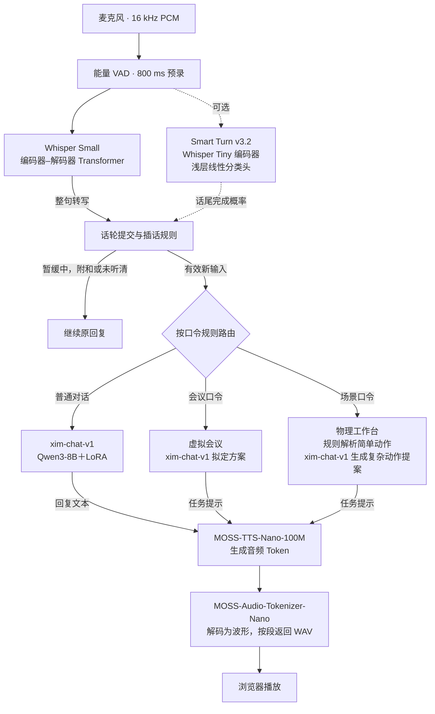
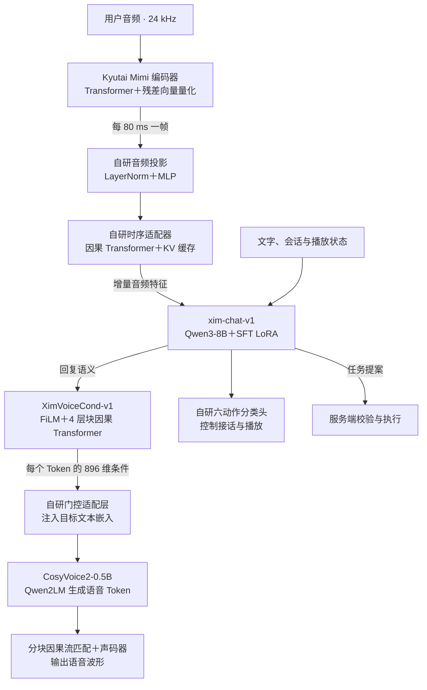

# Xim Duplex · 伴点

伴点是一个自托管的桌面陪伴机器人原型。它在朗读时继续收音：听到新讲话就暂停，听清「嗯嗯」可以续播，听到纠正则取消旧回复。主对话也能创建虚拟会议，或把「添加一个红色方块」交给浏览器里的物理工作台。


[观看演示](public/media/xim-demo.mp4) · [验证记录](docs/VALIDATION.md) · [全链路推理公式](docs/INFERENCE.md)

## 本地启动

需要 Node.js 22+。先在终端设置 `XIM_LOCAL_CHAT_URL` 和 `XIM_LOCAL_CHAT_MODEL`，分别指向本机或经 SSH 转发的自托管文本服务及其模型名。也可写入 `private/local-models.json` 的 `chat_url`、`chat_model` 字段。配置示例见 [.env.example](.env.example)，启动脚本读取进程环境变量。

```powershell
npm ci
npm start
```

打开 [本机对话页](http://127.0.0.1:8788)。仅启动 Node 服务即可浏览界面，生成回答还需文本模型就绪。

要启用麦克风，在另一个 PowerShell 终端运行 `./Start_Voice.ps1`，刷新页面并点击「实时语音」授权。Windows 默认使用已安装的中文听写引擎，也支持 Whisper 或经 SSH 转发的识别服务。远程识别会将语句音频发送至配置的服务器。可选的 Smart Turn 和语音合成服务分别由 `XIM_TURN_URL` 和 `XIM_LOCAL_TTS_*` 配置。[语音部署指南](docs/ASR_DEPLOYMENT.md)

## 当前可运行的语音链路

下图采用仓库做过组件实测的自托管配置。Whisper 和 Smart Turn 并行读取同一段音频。前者回答「说了什么」，后者估计「这句话说完了吗」。Windows 本机也可选择系统中文听写。[识别服务配置](docs/ASR_DEPLOYMENT.md) · [组件实测记录](docs/evaluations/2026-11-23/README.md)



- **听清与接话。** 浏览器播放时继续收音，能量 VAD 检测到新讲话就暂缓朗读。`faster-whisper` 运行 Whisper Small 做中文转写。可选的 Smart Turn v3.2 通过 ONNX 在 CPU 上分析末尾最多 8 秒的音频，给出话尾概率。最终转写为「嗯嗯」时可以续播，为「不对，我说的是明天」时则取消旧回复并处理纠正。[Smart Turn 模型卡](https://huggingface.co/pipecat-ai/smart-turn-v3) · [交互流程](docs/MODEL_FLOW.md)
- **对话与任务。** 三条分支共用同一个 xim-chat-v1。它基于 36 层的 Qwen3-8B，冻结基座后，对注意力的查询和值投影做秩为 16 的 LoRA 微调。聊天返回带情绪标签的文本段，会议使用单独的提示生成方案，复杂场景指令生成动作提案。会议执行须经用户确认，工作台会校验动作、对象和坐标。[模型卡](docs/XIM_CHAT_V1_MODEL_CARD.md) · [任务示例](docs/WORKBENCH_AND_MEETING.md)
- **把文字读出来。** 实测服务使用 OpenMOSS 的 100M 合成模型，根据短段文本和参考音色生成音频 Token，再用配套音频编解码器还原波形。该次测试关闭了 Xim 情绪适配器。未配置神经语音服务或合成失败时，浏览器可调用设备朗读。[合成模型与权重版本](docs/XIM_MOSS_ARCHITECTURE.md) · [实测配置](docs/evaluations/2026-11-23/tts.json)

交互记录可导出事件及相对时间。服务端在内存中暂存最近 100 条回答，自愿授权并评价后才将输入、回答和评价写入本机 `data/feedback.jsonl`。

## 模型进展与证据

### LiveBridge 目标模型流程

LiveBridge 计划复用 xim-chat-v1 的文本检查点，让它同时读取用户的语音特征、文字和会话状态。图中从音频编码到语音合成的完整链路仍待联合训练和集成。[融合架构与训练路线](docs/FUSION_ARCHITECTURE.md)



| 模块 | 怎么搭建、验证到了哪一步 |
| --- | --- |
| Mimi 与输入适配器 | Mimi 将音频编码为每秒 12.5 帧的表示，已有独立编码微基准。计划用 MLP 把帧映射到语言模型的嵌入空间，再由只读取当前及过去帧的 Transformer 对齐语音与文字。音频适配器和六动作分类头待训练。[编码实测](docs/evaluations/2026-11-23/README.md) |
| xim-chat-v1 | 语言侧采用 136 步监督微调（SFT）的检查点。100 条合成任务留出样本的正确率从 94% 升至 100%，后续 120 步 GRPO 未显示额外收益。音频输入和任务提案的联合训练仍在计划中。[训练与评测](docs/XIM_CHAT_V1_MODEL_CARD.md) |
| XimVoiceCond-v1 | 已实现的 PyTorch 模块接收语义张量、情绪、授权音色和状态 ID，用 FiLM 调制四层 512 维、8 头的 Transformer，各层共用 RoPE 系数。11 项合成张量测试覆盖掩码、增量缓存和梯度，权重待训练。[模型实现](training/xim_voice_cond.py) |
| CosyVoice 2 输出 | 桥接层只向目标文本嵌入加入语音条件，门控初值为零。9 项接口替身测试已验证输入和调用契约。官方权重接入后，才可验证从语音 Token 到波形的合成质量、首音和取消延迟。[桥接实现](training/xim_cosyvoice2_bridge.py) · [验证记录](docs/VALIDATION.md) |

真人重叠讲话与开放扬声器回声消除仍待实测。各组件的固定样本、测试机器和计时口径见[组件实测记录](docs/evaluations/2026-11-23/README.md)。

## 复现测试

```powershell
npm test                         # Node 单元和集成回归，部分用例调用 Python
npm run test:voice-cond          # Python + PyTorch，语音条件契约
npm run test:cosyvoice2-bridge   # Python + PyTorch，CosyVoice 2 接口契约
```

[训练与评估](training/README.md) · [原生双工研究方案](docs/DUPLEX_ARCHITECTURE.md) · [第三方软件与模型](THIRD_PARTY.md)
