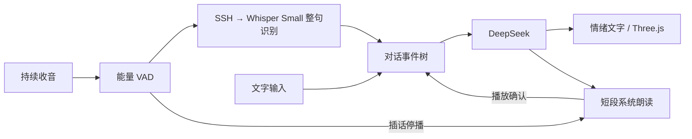

# Xim Duplex · 伴点

一个桌面陪伴机器人原型。Three.js 表情、情绪文字和沉浸式对话舱支持持续收听、插话停播与上下文回答。独立的物理工作台和会议空间可用语音操作。


[观看 ChatCut 演示成片](public/media/xim-demo.mp4) · [验证记录](docs/VALIDATION.md)

**[查看当前模型流程图与打断续接时序 →](docs/MODEL_FLOW.md)** · [原生全双工改造方案](docs/DUPLEX_ARCHITECTURE.md)

**v0.8.0**：[物理工作台与会议空间指南](docs/WORKBENCH_AND_MEETING.md)。可在主页面顶部进入；主对话语音区只保留「实时语音」开关。工作台支持语音建模、虚拟机械臂、计算和导出；会议空间支持具名 Agent、讨论、方案确认和交付。

v0.7.1 改善实时语音接话：将回答前的连续转写合成一轮；确认听懂后若实时模式迟迟未开口，可「接着回答」，也会在符合条件时自动由基础语音接续。MOSS-Live、Nex、模思转写和角色语音可单独启用，见 [模思接入指南](docs/MOSI_INTEGRATION.md)。

v0.6.2 保留播放位置确认和打断后的对话分支，修正连续语句丢失，并将当前机器的识别切换为服务器 Whisper Small（SSH 连接）。三条合成语音及静音检查通过，用户也已确认能识别真实讲话。此前 Windows 听写真人测试失败；复杂重叠对话仍待验证，不能宣称完整原生全双工已经可用。



## 当前能力

- DeepSeek 服务端调用，结构化输出异常时回退为可读文字；停止与重试不会追加重复的用户消息。
- 浏览器持续录音 → WebSocket → VAD → 语音识别 → DeepSeek → 系统语音合成。输出声音时输入保持开启，插话取消旧回答和朗读；已说出的连续语句按序识别，避免被下一句覆盖。
- 语音必须主动点击开启；关闭后立即释放麦克风。无语音服务时仍可打字。
- 六种表情和对应文字色，可关闭颜色与动作；无专注计时、任务执行或提醒页面。
- 自愿提交文字评价，生成可审阅的策略候选；独立真人比较满足门槛后才晋级，并保留旧版本。

这是可插话的级联工程原型，**不是复现 MOSS-Live 权重或经过对照试验的 SOTA 系统**。VAD 是能量阈值，不能可靠地区分附和、噪声和有效插话；使用耳机更稳。系统朗读的音色、可用性与延迟由浏览器及操作系统决定。当前仍等待完整文本后开始朗读。

## 启动

需要 Node.js 22+。Windows 本机运行：

```powershell
npm ci
# 只在本机设置密钥，不写入前端或仓库
$env:DEEPSEEK_API_KEY='你的密钥'
npm start
```

打开 http://127.0.0.1:8788 。也可指定 `XIM_CONFIG` 指向仓库外的私有 JSON 配置，字段为 `api_key`；兼容原有 BandiPrivate 本机配置。

新安装建议 Python 3.11+；Windows 未配置远程服务时使用已安装的中文听写引擎。当前机器已通过 `private/asr.json` 选择 SSH 连接的服务器识别。建议在 PowerShell 7 的另一个终端启动：

```powershell
./Start_Voice.ps1
```

配置远程识别时，启动脚本检查连接；连接失效会请求 SSH 密码并重建通道，密码不保存到文件。SSH 主机须已在 `known_hosts` 中，脚本不会自动信任新主机。没有远程配置时，兼容路径要求已安装中文听写引擎，服务监听 127.0.0.1:8791。刷新页面，点击「开始语音」，授权麦克风。

远程部署说明见 [识别服务部署](docs/ASR_DEPLOYMENT.md)。`private/`、模型、依赖目录和录音均不进入 GitHub；配置文件只存连接信息，不存密码。远程识别启用时，麦克风音频发送到用户配置的服务器处理。

设置 `$env:ASR_ENGINE='whisper'` 后运行相同脚本，可在支持该依赖的环境安装并使用 faster-whisper。首次安装与下载模型较慢；tiny 是 CPU 起步配置，`ASR_MODEL=small` 可切换模型，GPU 另需匹配 CUDA。该 Windows 机器的应用控制拦截了新装 NumPy 原生组件，因此没有在本机加载它；当前实际 Whisper 推理运行在独立 Linux 服务器。不要关闭系统安全控制来加载组件。

Linux/macOS 可创建虚拟环境、安装 `requirements-asr.txt` 后运行 `python scripts/asr_worker.py`。配置项见 `.env.example`；当前不自动读取 `.env`。

## 改进与评估

```powershell
npm test
npm run evolve -- propose data/feedback.jsonl
npm run evolve -- promote path/to/human-evaluation.json
```

候选生成至少需要 10 条已授权负反馈，晋级至少需要 50 条独立真人对照。测试中的合成数据只验证门槛行为，不代表产品已通过真人实验。数据与训练权重不进入 Git。细节、模型组合与官方参考见 [模型方案](docs/MODEL_STRATEGY.md)。

演示视频的镜头、文字和制作状态见 [视频简报](docs/VIDEO_BRIEF.md)。演示用于解释交互，不作为延迟、情绪识别或模型效果的实测证据。

## 数据范围

密钥只保留在服务端。对话默认只在当前页面内存中，服务端为评价暂存最多 100 条回答，刷新/重启不会恢复对话。音频不落盘；勾选授权并点击评价后，对应输入、回答及评价写入本机 `data/feedback.jsonl`。删除该文件可移除反馈记录。

这是个人本地服务，默认仅监听回环地址。公开部署前另需账号隔离、服务端会话、HTTPS、用量控制和部署级隐私设计。

第三方软件和模型说明见 [THIRD_PARTY.md](THIRD_PARTY.md)。
