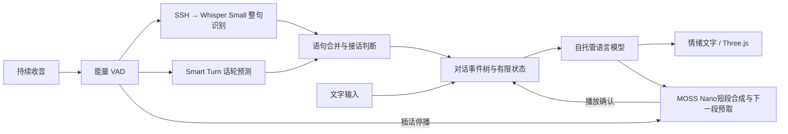

# Xim Duplex · 伴点

一个桌面陪伴机器人原型。Three.js 表情、情绪文字和沉浸式对话舱支持持续收听、插话停播与上下文回答。独立的物理工作台和会议空间可用语音操作。


[观看 ChatCut 演示成片](public/media/xim-demo.mp4) · [验证记录](docs/VALIDATION.md)

**[查看当前模型流程图与打断续接时序 →](docs/MODEL_FLOW.md)** · [原生全双工改造方案](docs/DUPLEX_ARCHITECTURE.md)

v0.10.0 新增两阶段插话控制：检测到讲话先暂缓播放，附和或未识别片段可续播，纠正、明确让出与新输入才取消旧回答。新增不含录音和原文的交互验证记录导出；[架构与流程](docs/MODEL_FLOW.md)说明已运行组件和待训练网络的区别。

多任务模型 **[xim-chat-v1](docs/XIM_CHAT_V1_MODEL_CARD.md)** 已完成基于 Qwen3-8B 的 SFT 136 步与 GRPO 120 步。当前采用 SFT 检查点，任务模板留出正确率 94% → 100%；GRPO 奖励组无方差，未证明额外收益。[训练记录与运行方法](training/README.md)保留真实指标和限制。

**自托管产品路线。** 不调用 MOSS 或 DeepSeek 云 API。主对话、[会议空间与物理工作台](docs/WORKBENCH_AND_MEETING.md)共用 Xim 的收音链路；当前这台机器使用服务器 Whisper + 自托管语言模型 + MOSS Nano 本地语音，语音服务不可用时回退设备朗读。Xim 条件残差层尚无已训练的适配器权重；状态与限制见[模型架构](docs/XIM_MOSS_ARCHITECTURE.md)。

2026-11-23 组件实测：3.5359 秒固定音频上，Whisper-small 完整转写 P50 894.005 ms；Smart Turn 服务端 P50 32.630 ms；Qwen3-8B＋SFT 非流式完整回复 P50 483.235 ms；CPU MOSS Nano 完整 WAV 平均 RTF 0.8195。样本、逐次结果及限制见[组件实测](docs/evaluations/2026-11-23/README.md)，不能解释为真人端到端或重叠语音指标。[附件改造方案审阅](docs/ARCHITECTURE_REVIEW.md)给出采纳、修改与拒绝项。



## 当前能力

- 仅调用自托管语言模型，结构化输出异常时回退为可读文字；停止与重试不会追加重复的用户消息。
- 浏览器持续录音 → WebSocket → VAD／Smart Turn → 语音识别 → 两阶段插话控制 → 自托管语言模型 → 本地神经语音或设备朗读。输出声音时输入保持开启；附和可续播，纠正会取消旧回答；连续语句按序识别，避免被下一句覆盖。
- 语音必须主动点击开启；关闭后立即释放麦克风。无语音服务时仍可打字。可导出仅含事件、相位和相对时间的验证记录，不包含录音或对话原文。
- 六种表情和对应文字色，可关闭颜色与动作；主对话不直接执行任务，会议和工作台分别提供受约束的执行入口。
- 自愿提交文字评价，生成可审阅的策略候选；独立真人比较满足门槛后才晋级，并保留旧版本。

这是可插话的级联工程原型，**尚未完成原生端到端双工训练或独立用户对照评测**。两阶段控制目前使用最终转写和规则分类，不能可靠识别所有背景对话、口音与噪声；开放扬声器仍需 AEC，使用耳机更稳。当前仍等待完整文本后开始朗读，神经 TTS 单段生成不可立即中止，但前端可停播并丢弃过期音频。

## 启动

需要 Node.js 22+。Windows 本机运行：

```powershell
npm ci
npm start
```

配置 `private/local-models.json` 指向自托管文本服务，或设置 `.env.example` 中的 `XIM_LOCAL_CHAT_URL` 与 `XIM_LOCAL_CHAT_MODEL`。服务需运行在本机回环地址或通过 SSH 转发。访问 http://127.0.0.1:8788 。模型未运行时不会回退到第三方 API。

新安装建议 Python 3.11+；Windows 未配置远程服务时使用已安装的中文听写引擎。当前机器已通过 `private/asr.json` 选择 SSH 连接的服务器识别。建议在 PowerShell 7 的另一个终端启动：

```powershell
./Start_Voice.ps1
```

配置远程识别时，启动脚本检查连接；连接失效会请求 SSH 密码并重建通道，密码不保存到文件。SSH 主机须已在 `known_hosts` 中，脚本不会自动信任新主机。没有远程配置时，兼容路径要求已安装中文听写引擎，服务监听 127.0.0.1:8791。刷新页面，点击「开始语音」，授权麦克风。

远程部署说明见 [识别服务部署](docs/ASR_DEPLOYMENT.md)。`private/`、模型、依赖目录和录音均不进入 GitHub；配置文件只存连接信息，不存密码。远程识别启用时，麦克风音频发送到用户配置的服务器处理。

设置 `$env:ASR_ENGINE='whisper'` 后运行相同脚本，可在支持该依赖的环境安装并使用 faster-whisper。首次安装与下载模型较慢；tiny 是 CPU 起步配置，`ASR_MODEL=small` 可切换模型，GPU 另需匹配 CUDA。该 Windows 机器的应用控制拦截了新装 NumPy 原生组件，因此没有在本机加载它；当前实际 Whisper 推理运行在独立 Linux 服务器。不要关闭系统安全控制来加载组件。

Linux/macOS 可创建虚拟环境、安装 `requirements-asr.txt` 后运行 `python scripts/asr_worker.py`。配置项见 `.env.example`；当前不自动读取 `.env`。

## 改进与评估

```powershell
npm test
npm run evolve -- propose data/feedback.jsonl
npm run evolve -- promote path/to/human-evaluation.json
```

候选生成至少需要 10 条已授权负反馈，晋级至少需要 50 条独立真人对照。测试中的合成数据只验证门槛行为，不代表产品已通过真人实验。数据与训练权重不进入 Git。细节、模型组合与官方参考见 [模型方案](docs/MODEL_STRATEGY.md)。

演示视频的镜头、文字和制作状态见 [视频简报](docs/VIDEO_BRIEF.md)。演示用于解释交互，不作为延迟、情绪识别或模型效果的实测证据。

## 数据范围

密钥只保留在服务端。对话默认只在当前页面内存中，服务端为评价暂存最多 100 条回答，刷新/重启不会恢复对话。音频不落盘；勾选授权并点击评价后，对应输入、回答及评价写入本机 `data/feedback.jsonl`。删除该文件可移除反馈记录。

这是个人本地服务，默认仅监听回环地址。公开部署前另需账号隔离、服务端会话、HTTPS、用量控制和部署级隐私设计。

第三方软件和模型说明见 [THIRD_PARTY.md](THIRD_PARTY.md)。
