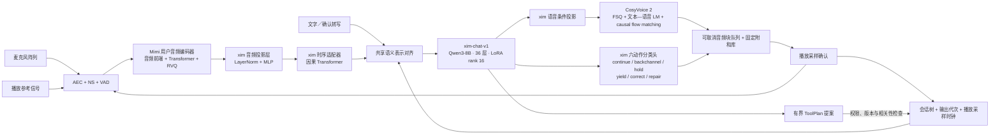

# 桌面陪伴玩偶改造方案审阅

审阅对象：《桌面陪伴玩偶_LLM架构与语音编码器改造方案.xls》（架构总览、LLM 改造、语音编码器、离线在线分工、三者关系）。日期：2026-11-23。

## 总体判断

附件的“设备侧感知＋边缘／服务器生成”、降低重复计算、短语音预制和频谱表征研究有价值，但不建议按原表直接实施。当前最合适的产品路线是：**保留可取消的流式级联，先把选择性轮次、恢复和播放时间轴做可靠；将原生双音频流模型作为独立研究分支。**

v0.10.0 已落地两阶段控制：检测到讲话先暂停，附和或未识别片段可恢复，纠正／让出／新输入才取消旧回答。它仍是应用层策略，不是原生端到端全双工模型。

## 逐项技术审阅

| 附件主张 | 判断 | 建议实现 |
|---|---|---|
| 块投机解码让主模型“整段只前向一次” | 表述不准确。通常是每个 draft block 由主模型并行校验，随后从第一个不被接受的位置继续；不是整个开放回答只进行一次前向计算。 | 先测 tokens/s、接受率、首 token 与显存，再决定是否采用。保留 KV cache、取消与代次检查。 |
| 禁止 abort，避免打断损坏上下文 | 不适合开放对话。用户纠正或要求停止时，旧输出必须可取消。 | 使用 `AbortController`／服务端取消、输出 epoch、过期包丢弃和已播放前缀。取消不删除用户意图。 |
| 预制语音替代通用 TTS | 只适合“嗯、我在听、稍等”等固定短句；无法覆盖开放回答。 | 固定附和用低延迟音频库，正文用流式 TTS；两条路径共享播放时钟与取消协议。 |
| 禁用流式 ASR，改用离线整句识别 | 会增加等待，并阻碍增量语义插话。 | 保留轻量 VAD／唤醒事件支路，同时引入 interim／revision／final 流式 ASR。临时转写不直接创建新用户轮次。 |
| 禁用通用 AEC，以频谱掩蔽代替 | 外放玩具需要处理扬声器到麦克风的回声。仅靠频谱表征无法保证回声抑制。 | 保留 AEC／AEC3 类基线，以同步参考播放信号做回声控制；频谱方法只作为可消融的增强项。 |
| HRSE 定长频谱 embedding 替代语音 codec | 两者用途不同。定长 embedding 可用于检索、说话人／场景表征，不能直接提供可解码的生成侧离散音频 token。 | 将 HRSE 类表征限定在检索与选择性注意实验；生成继续使用经过验证的音频 codec。 |
| ESP32-S3 NPU 承担 3B LLM | 硬件假设不成立。ESP32-S3 不具备运行此类 3B LLM 的通用 NPU 与内存条件。 | ESP32-S3 负责音频 I/O、触摸、电机与低功耗唤醒；LLM 放在 RK3588 级边缘计算或服务器，按实测分配。 |
| 块稀疏注意力自动省时 | 只有 mask 不等于加速；需要合适训练、布局和高效率 kernel。 | 先以稠密模型为正确性基线，再用相同输入比较 kernel 级延迟、显存和质量。 |
| 离线／在线严格二选一 | 桌面产品需要按隐私、延迟和成本动态分工。 | 唤醒、AEC、VAD、基础动作本地；复杂生成可在获授权的边缘／服务器运行；断网保留明确降级能力。 |

## 推荐目标架构：无 MOSS 跨模态融合

融合是表示对齐和适配参数联合训练，不是模型权重直接相加。Mimi 仅提供用户音频编码，不等于中文语义理解；xim-chat-v1 是确定的共享语言核心，不是任意替换的 LLM 占位；CosyVoice 2 仅为待接入合成器。SpeechTokenizer 只作语义／声学解耦对照，不进入当前目标主链路。具体结构和训练步骤见[融合模型设计](FUSION_ARCHITECTURE.md)。

Mimi 本机独立编码微基准已完成，但融合检查点、LiveBridge 集成、CosyVoice 2、AEC 和实体玩偶均未训练或未测；第三方上游指标不得写成 Xim 效果。

关键不变量：

1. 已播放内容不可改写；未播放内容可取消，取消后不得复活。
2. 附和默认不创建新用户轮次；纠正必须形成新分支，并携带最后确认的播放前缀。
3. 临时转写只用于预测，最终转写与置信度到达后才提交开放回答。
4. 后台任务使用独立 ID 和版本，旧任务结果不得覆盖新对话。
5. 记忆只保存用户明确确认的事实与偏好，提供查看、删除和关闭选项。

## 分阶段实验

- **P0：当前原型。** 固定事件与浏览器测试、组件时延、交互 trace 隐私检查；已完成结果见 `evaluations/2026-11-23/`。
- **P1：开放扬声器。** 同步采集播放参考与麦克风信号，比较 AEC 开／关；测 ERLE、双讲漏识别、停播声学时延，不以浏览器 UI 时间代替。
- **P2：语义轮次。** 按说话人划分开发／留出集，覆盖附和、思考停顿、纠正、换题、背景对话；与 VAD-only 做同条件比较。
- **P3：流式生成。** 比较整句与流式 ASR／LLM／TTS 的可听首音、取消成本与音质；任何投机解码或稀疏化单独做消融。
- **P4：原生双流研究。** 只有在数据、许可、训练算力与级联基线齐备后，再训练用户／助手双音频流模型。

## 附件方案的采纳结论

采纳：端侧轻量感知、短附和预制、缓存与增量计算、频谱表征研究、明确离在线分工。

修改后采纳：投机解码、块稀疏、频谱增强、边缘算力分配。

不采纳：全面禁止 abort、全面禁止流式 ASR、以 HRSE 替代生成 codec、在外放全双工中取消 AEC、让 ESP32-S3 承担 3B LLM。
