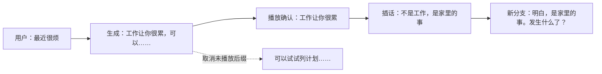

# 从可插话原型到语义全双工

更新：2026-11-16。本文区分已经实现、研究设计与待验证指标。没有完成真人麦克风验收，也没有训练新的语音基础模型。

## 问题定位

用户反馈“正在听，但没有识别文字”。当前链路是连续 PCM 输入 → 能量 VAD 切句 → Windows 中文整句听写 → DeepSeek 整段生成 → 浏览器朗读。收音、断句、转写是三个阶段；麦克风开启不代表识别成功。

原版固定 RMS 门限 0.025 容易漏掉轻声，持续背景声又可能延迟断句。更根本的问题是 Windows 听写不提供本产品所需的稳定中文流式结果。仅降低门限无法解决口音、回声和识别模型能力问题，还可能增加误打断。此机器 Whisper 的 NumPy 原生依赖被应用控制阻止；没有绕过该限制。

另外，原版把生成的整段答案提前写入历史，导致未播出的后半段被当成共享上下文；生成过程中被取消的用户问题则可能丢失。

## 本次已实现

- 展示输入音量、当前麦克风、收音/识别阶段和空识别原因；允许切换麦克风和轻声/标准/嘈杂环境灵敏度。
- 默认门限改为 0.012，结束门限为启动门限的 0.8；保留 160 ms 启动、700 ms 静音结束和 14 秒上限。这些是可调工程参数，不是最优值。
- 增加手动结束当前语句，麦克风保持开启；这是排障和断句辅助，不能作为全双工达标证据。
- 内存中记录对话节点的 parent、用户原话、生成状态、播放确认位置及打断事件。取消生成仍保留用户意图。
- 朗读按短段排队，利用 boundary/end 回调确认播放前缀；打断后撤销队列，旧回调不能推进新轮次。没有 boundary 支持时只确认已完成的小段，保守地排除当前段。此位置是浏览器播放事件的估计，不是物理声学检测，也不能证明人实际听见。
- 后续请求附带打断时的阶段与前缀，让模型结合最新纠正或补充重新回答，未播放的草稿不进入助手历史。完整文字仍显示在对话窗口，语音历史与已显示文字有意区分。

本次仍不具备流式转写、流式模型输出、流式神经 TTS、语义轮次模型和说话人选择。能量检测到“嗯嗯”也会停止朗读；识别失败后不会擅自恢复旧答案。ASR 采用最新语句优先策略，快速连续分段时可能取消旧转写；真实流式版本应按语句 ID 合并保留已说出的内容，只取消过期的回答。

## MOVA 是否合适

用户提供的论文是 [MOVA: Towards Scalable and Synchronized Video–Audio Generation](https://arxiv.org/html/2602.08794v2)。其目标是图像/文本条件下生成同步音视频，用视频 DiT、音频 DiT、双向 Bridge 和同一物理时间坐标的 RoPE 连接模态；采用 flow matching，并非持续接收用户声音的对话解码器。

我们的架构判断：可借鉴时间对齐与跨模态桥接，但不能直接把视频塔换成 ASR 就得到全双工。改造至少需要因果/分块注意力、可增量更新的缓存、用户与助手双音频流、播放确认、轮次行为监督以及重叠语音交互数据；原任务的训练目标也不再充分。这里的“同一时间轴”是设计启发，并非本项目已经实现 MOVA 的 Aligned RoPE 或加载其权重。

桌面玩具已有 Three.js 实时角色，优先让表情事件跟随实际音频播放时间，避免把逐帧视频生成放进低延迟对话关键路径。MOVA 更适合离线演示素材或未来音视频生成研究分支。

## 推荐的两条实现路线

### 近期：可替换的流式级联

持续麦克风输入 → 回声处理/目标说话人 → 中文流式 ASR → 语义轮次管理 → 流式 LLM → 流式 TTS → 带播放确认的音频队列。输入始终运行，不能等输出结束才监听。

[FunASR](https://github.com/modelscope/FunASR) 提供中文流式识别路径，可评估其在线 Paraformer 等模型；[CosyVoice](https://github.com/FunAudioLLM/CosyVoice) 提供流式文本输入和音频输出能力，可作为 TTS 候选。二者仅为待部署/实测的候选，不能直接套用上游延迟作为本平台成绩。DeepSeek 仍可担当文本规划与回应，API 不允许我们编辑其内部 CoT 或 KV 缓存。

需要让 ASR 发出 interim/revision/final，而不是只返回一句最终文本。临时转写只用于预判，不直接提交用户轮次。语义控制器联合最近转写、韵律、VAD、回声信息和助手播放进度，输出 continue / backchannel / yield / correct / resume / topic_shift。模型不确定时先让出话语权，再澄清。

### 研究：原生双流语音模型

[Moshi](https://github.com/kyutai-labs/moshi) 直接建模用户音频流、助手音频流及助手语音对应的文本，研究基础比 MOVA 更贴近本任务。它的文本流不等同于允许外部修改隐藏推理。是否适合中文陪伴仍需检查目标检查点的语言能力、许可、算力和真实交互效果，不能宣称直接部署即可达到中文最佳水平。

若选择自研：共享因果时间主干，接入用户语音编码器、助手语音解码器、轮次行为头及轻量表情头。只对过去与当前可用帧做跨流注意力；跨模态桥接使用统一时钟和有界窗口，避免训练时读取未来声音。已播放输出构成不可撤销前缀，未播放候选可以取消或重生成。服务端应持有权威会话状态，浏览器只上报播放进度和用户事件。

## 对话树如何处理打断

这是一棵可观察的对话事件树，不是对隐藏 CoT 做插入操作。

期望的流式协议（尚未整体实现）：每个会话、输入语句、输出代次和音频块各有 ID；ASR revision 带稳定前缀；playback.ack 带设备实际播放采样数；speech.start 触发暂停，语义判断再决定恢复/取消；取消递增输出代次，过期 LLM/TTS 包直接丢弃。新分支携带被打断节点、确认播放前缀、新输入、显式对话状态。长时记忆仅写入最终确认的事实，不写入猜测和被纠正的事实。

“嗯嗯”应作为附和保留主线；“不是，我指的是……”应纠正当前节点；“等下，换个问题”应停止并切换目标；“刚才没听清”应从最后确认位置附近重述。用户可以打断机器人；机器人也需要判断自然接话、必要的简短澄清及不该抢话的时机，不能对每个停顿抢答。

## 训练与递归改进方案（尚未执行）

1. 先建立合法授权的双通道中文交互集。每段记录输入/输出音频时钟、人工转写、重叠范围、用户打断意图、应暂停/继续的时刻、已播放边界和正确续接答案。覆盖附和、纠正、换题、口音、轻声、外放、多人及噪声。当前产品不保存原始音频；收集训练音频需另设明确授权。
2. 优先训练轮次行为头与续接策略；再决定是否微调语音主干。可分别使用行为分类损失、转写/文本预测损失、声学生成损失及人类偏好优化。损失权重和桥接结构需要消融实验，不预设“模型越多越好”。
3. 构建失败集合 → 产生候选 → 按说话人和会话隔离的冻结测试集 → 人工盲评与性能评估 → 达标晋级 → 留存上一版回滚。合成打断只能扩充训练，不作为真人效果证明。
4. 偏好目标是被理解、自然接话、适度支持、尊重纠正与停止；不能只优化正面语气或长时停留。原仓库 evolution 仅优化提示策略，本方案并未让其自动微调权重。

## 产品验收目标，不是已测结果

| 能力 | 测量方法与目标 |
|---|---|
| 中文识别 | 安静/噪声/外放分组计算字错误率 CER；先以安静 CER ≤10% 为试验目标，不能仅看几条合成音频 |
| 停播 | 用户有效插话声学起点到输出设备停止发声，P95 ≤300 ms；包含 VAD、传输和音频队列 |
| 接话 | 用户有效话轮结束到首个可听音频，P95 ≤1500 ms；包含 ASR、推理、TTS，不只测模型首 token |
| 续接 | 纠正/换题/补充/复述的人工标注任务成功率 ≥90%，报告样本数与区间 |
| 附和/噪声 | 分别报告误停止率、漏停止率和误回应率，不能靠降低灵敏度掩盖漏识别 |
| 时间与内容一致 | 未播出的旧答案不得进入语音共享前缀；旧代次音频不得在打断后复活 |
| 主观体验 | 与上一版本做匿名顺序随机的成对比较；按用户分层，报告置信区间 |

这些是本产品的验收定义，并不是行业存在一项统一的“DUPLEX 认证”。只有真实设备、真实说话者和重叠对话测试达标，才可以宣称达到对应体验目标。
