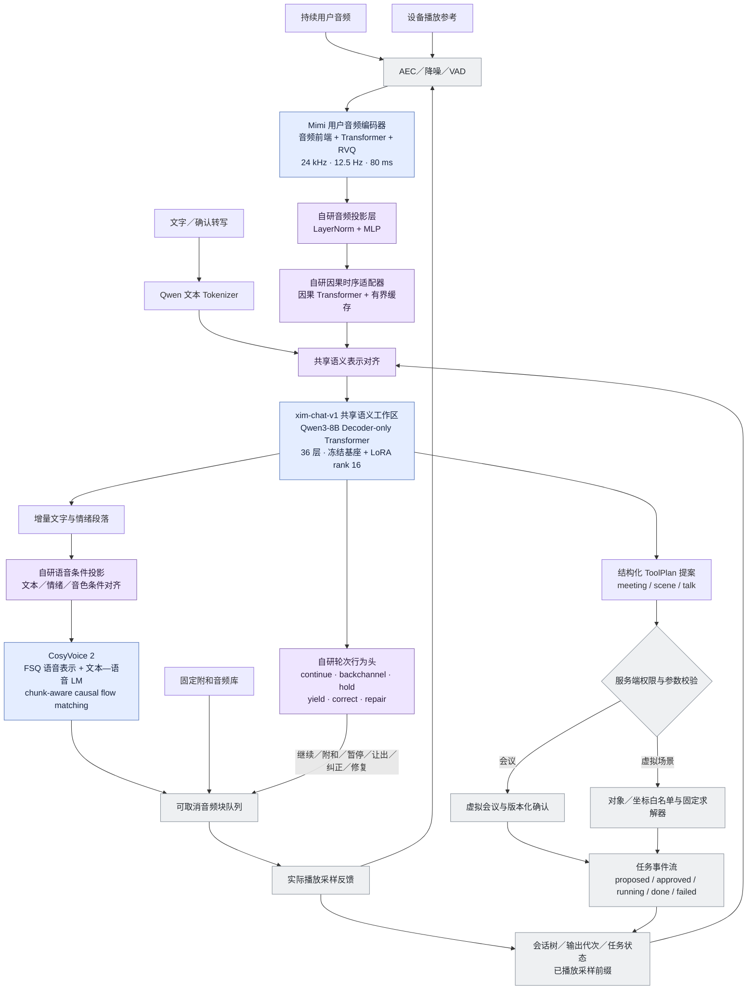

# Xim LiveBridge：无 MOSS 跨模态融合架构

更新时间：2026-11-24

> **状态：目标设计，`NOT_TRAINED / NOT_INTEGRATED / NOT_TESTED`。** 本文描述拟开发的融合模型，不是当前可运行 Demo 的部署记录。当前没有融合检查点、跨模态训练数据、CosyVoice 2 部署结果或真人重叠对话成绩。现有 MOSS Nano 只保留在历史级联基线中，不进入本架构。

## 1. 融合的定义

Xim 采用 **Mimi 用户音频编码器＋自研跨模态适配层＋xim-chat-v1＋CosyVoice 2**。融合指让语音、文字、轮次、任务与已播放状态通过可训练投影进入同一语义工作区，并用联合目标训练适配参数；不是把不同模型的权重直接相加，也不只是把三个独立服务串起来。

上游模型保持各自来源、权重和许可。近期交付物应是可复现的适配器与组合检查点清单；只有完成实际训练、导出和加载验证后，才可称为“已融合模型”。

## 2. 总图

蓝色为已有上游模型，紫色为拟训练的自研适配模块，灰色为规则、工程控制或数值求解器。

## 3. 模型结构与接口

| 模块 | 结构与输入 | 输出及边界 |
| --- | --- | --- |
| Mimi 用户音频编码器 | 音频前端、Transformer 编码与 RVQ；上游为 24 kHz 全流式 codec，12.5 Hz 表示，对应 80 ms 帧。只使用用户侧编码，不使用其解码器，不加载 Moshi 作为 Xim 对话模型。 | 帧级音频表示。它本身不等于中文转写、语义理解或会议规划。首 codebook 的上游 WavLM 蒸馏是预训练来源，不是 Xim 的训练结果。 |
| 音频投影层 | 带 LayerNorm 的 MLP，将 Mimi 表示映射到 xim-chat-v1 可接收的表示空间。具体维度必须从实际权重配置读取，本文不虚构张量尺寸。 | 与文字表示维度兼容的音频嵌入；输入带时间戳、音频帧 ID 和输入代次。 |
| 因果时序适配器 | 因果 Transformer，只读取过去与当前帧；维护有界 KV 缓存，接收音频嵌入及可用转写 revision。层数、窗口和训练超参数由消融实验确定。 | 增量语义特征、韵律特征和轮次判断所需上下文；不能使用未来音频。 |
| xim-chat-v1 | Qwen3-8B 解码器式自回归 Transformer，36 层，基座 8,190,735,360 参数；冻结基座＋LoRA rank 16，可训练参数 7,667,712。由现有 SFT 136 步检查点初始化。 | 文字与情绪段落、轮次行为头的共享语义、结构化 ToolPlan。GRPO 120 步未晋级，不能作为额外效果。 |
| 语音条件投影 | 将文本、允许的情绪标签、经授权音色 ID 和会话条件映射到 CosyVoice 2 的实际条件接口。先冻结合成器，单独训练投影。 | 合成条件，不是新的声码器。接口须在集成时按 CosyVoice 2 真实张量契约实现，不能假设可直接接收 Mimi token 或 Qwen 隐藏状态。 |
| CosyVoice 2 | FSQ 语音表示、文本—语音 LM、chunk-aware causal flow matching，再经其声码器输出波形。只替代输出侧合成功能，不承担对话、轮次或工具权限。 | 分块语音候选；增量文本、首音、自然度、取消与并发均待 Xim 实测。 |
| 轮次行为头 | 从共享语义工作区读取当前可用状态，输出 continue／backchannel／hold／yield／correct／repair 六动作。 | 交互动作，不是会议任务或机械臂动作；低置信度先 hold，不能无期限等待。 |

### 接口必须显式记录

- `audio.frame`：会话 ID、帧 ID、采样时钟、音频表示和输入代次。
- `transcript.revision`：稳定前缀、临时文本、最终文本、置信度和来源；临时文本不能直接提交开放回答。
- `turn.action`：动作、置信度、触发证据时间、目标输出代次。
- `speech.chunk`：文本范围、音频范围、输出代次、取消状态；过期块直接丢弃。
- `playback.ack`：实际播放采样数和已确认文本前缀，不用 UI 动画时间替代。
- `tool.event`：提案 ID、任务版本、权限结果与执行状态；模型无权自行扩大工具权限。

## 4. 联合训练方案（尚未执行）

### P0：冻结基线与数据契约

固定 Mimi、Qwen3-8B 和 CosyVoice 2 的版本、许可与校验值；以现有 SFT 检查点初始化语言侧。收集合法授权的双通道中文交互数据，记录转写、重叠区间、轮次行为、已播放边界和工具确认。当前产品不保存原始录音，训练采集必须另行授权。

### P1：音频接入与轮次训练

冻结 Mimi 和 Qwen 基座，只训练音频投影、因果时序适配器与轮次行为头。使用文字对齐／转写辅助损失、帧—文表示对齐损失和六动作分类损失；按说话人隔离训练、开发和测试集。没有真实数据前不生成“融合效果”数字。

### P2：对话与工具联合适配

保持 Qwen 基座冻结，联合训练上述适配器和现有 LoRA。优化文字回复、情绪契约、轮次行为和 ToolPlan 结构正确性；工具训练只覆盖允许的会议／虚拟场景提案。会议确认、对象与坐标校验、数值求解和权限拒绝仍由外部确定性模块负责。

### P3：语音条件训练

先冻结 CosyVoice 2，训练语音条件投影，以经授权的文本、情绪、音色和成对语音监督音色与表达条件。分别测量可听首音、自然度、字错误率、说话人一致性与取消成本。固定附和不占用开放回答生成链路。

### P4：受控联合微调与晋级

只有 P1–P3 的独立基线成立，才考虑选择性解冻适配层或额外 LoRA，不默认全量训练所有上游模型。组合目标可写为：

`L = λtext·Ltext + λalign·Lalign + λturn·Lturn + λtool·Ltool + λspeech·Lspeech`

各项权重通过消融确定，不预设数值。候选必须在冻结留出集、真实产品接口、真人盲评和资源预算上同时达标，并保留上一版回滚。

## 5. 双工状态与物理控制

Mimi、适配器和 xim-chat-v1 在用户讲话与机器人发声时持续运行；语音输出不是关闭输入的理由。播放参考进入 AEC，实际播放采样回写会话树，保证未播放草稿不进入共享历史。

语音可以创建虚拟会议、修改会议方案和提交虚拟物理场景动作，但必须经过 `ToolPlan → 权限与参数校验 → 用户确认（适用时）→ 任务事件`。纠正可取消未播放音频与未执行提案；已经完成的计算不能虚构为“未发生”。Three.js 与 Cannon ES 不是 LLM，当前也不控制实体机械臂。

## 6. 证据与验收门槛

目前只有 Mimi 在本机 Windows CPU 的独立编码微基准：3.84 秒合成音频、48×80 ms 编码步、n=10，P50 3793.193 ms、P95 4765.936 ms。这不是实时、语义、重建音质、服务器或融合链路结果。

融合模型、CosyVoice 2 接入、AEC、真人重叠对话和实体玩偶均为 **NOT_TESTED**。后续至少按统一设备和音频条件报告：

- 有效插话声学起点到停止发声的 P50／P95，目标 P95 ≤500 ms。
- 用户有效话轮结束到首个可听音频的 P50／P95，目标 P95 ≤1500 ms。
- 纠正、换题、补充、复述的成功率与置信区间，试验目标 ≥90%。
- 附和／背景噪声的误停止、漏停止、误回应率，以及分组 CER。
- 相同文本与音色条件下的 TTS 首音、RTF、自然度与取消成本。
- 会议与虚拟场景的提案正确率、越权拒绝率、确认失效与取消一致性。

这些是验收定义，不是已测结果；不得用上游论文数字或单模块延迟拼成端到端成绩。
