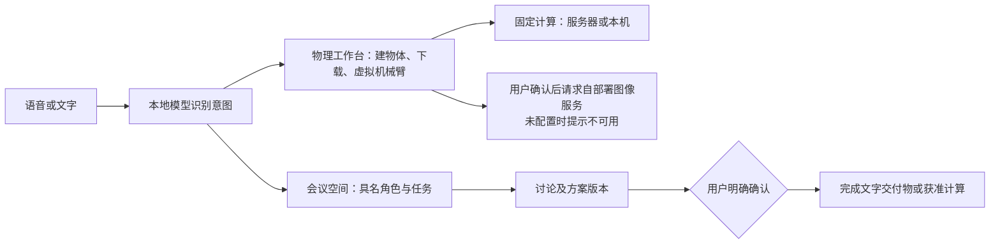
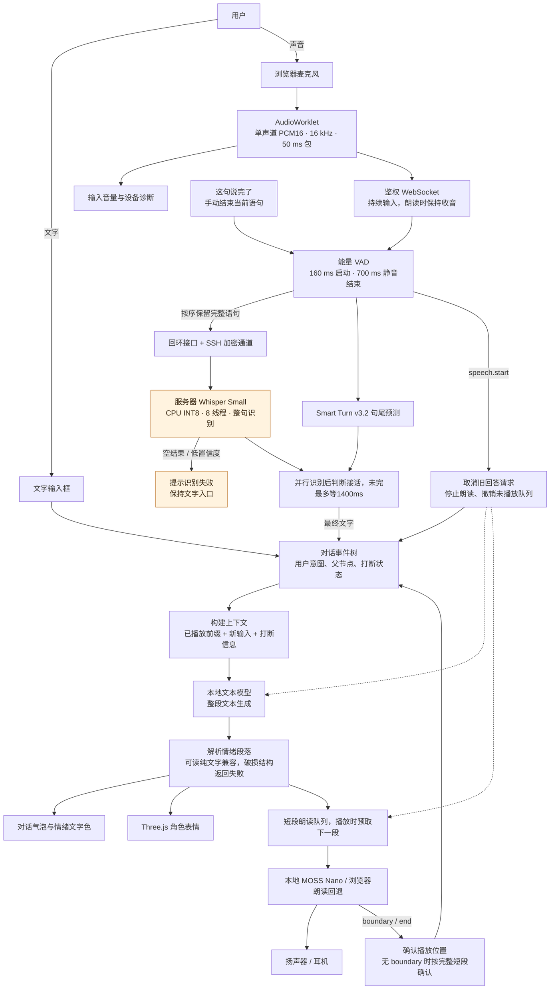
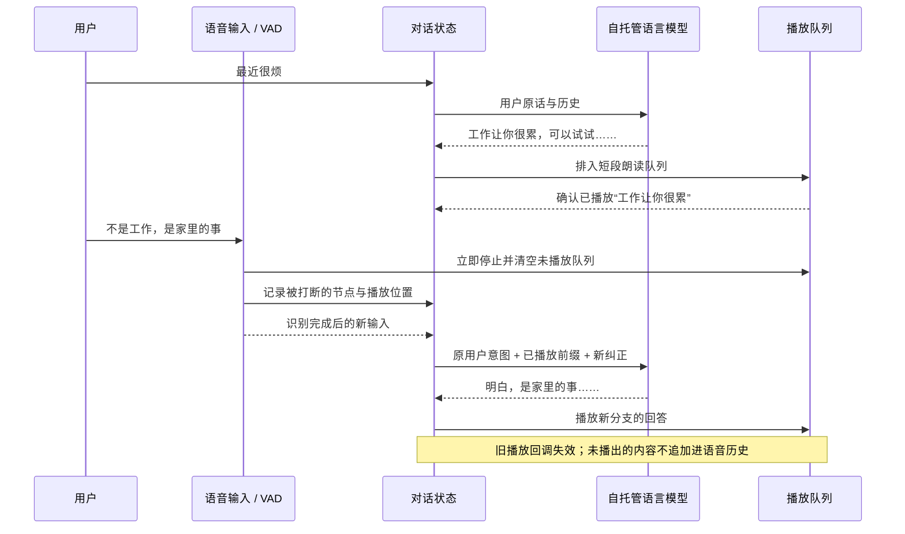
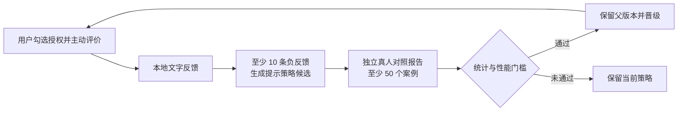
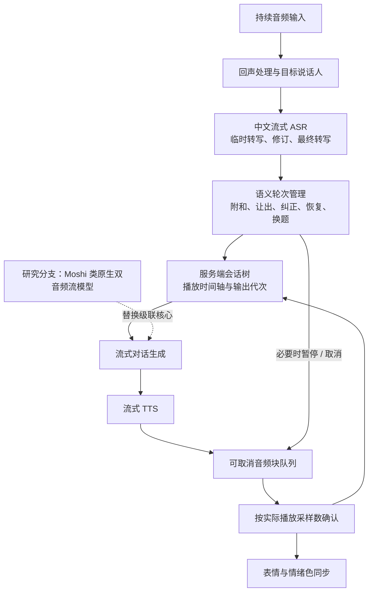
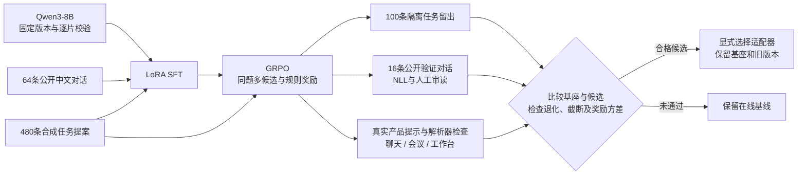

# Xim Duplex 当前模型与对话流程

更新时间：2026-11-16 · 代码版本：v0.9.3

现行产品不调用 MOSS 云 API。当前主对话链路是 Xim 收音与打断管理 → 自部署 Whisper + Smart Turn 话轮判断 → 有限交互状态 → 自托管语言模型 → 本地 MOSS Nano 语音，服务不可用时回退设备朗读。语音参数与独立算法的区别见 [Xim MOSS 架构](XIM_MOSS_ARCHITECTURE.md)，实际启用状态以服务配置和验证记录为准。

工作台与会议空间使用自托管语言模型处理结构化任务，由 Xim 检查方案、确认和执行状态。详细操作与验证边界见 [使用指南](WORKBENCH_AND_MEETING.md)。

主对话可配置独立文本和声音服务，图像生成改为自部署服务接口；见[部署说明](SELF_HOSTED_ROADMAP.md)。本机已连接服务器的 Nano 语音，图像模型尚未部署。自主研发与训练边界见[技术路线](MODEL_STRATEGY.md)。

**状态：可插话的级联原型。Windows 听写在真人测试中失败后，已切换为经 SSH 连接的 Whisper Small；三条合成语音与静音检查通过，用户已确认能识别真实讲话。复杂重叠对话仍待验证。** 下图描述当前这台机器配置的实际链路；目标架构单独列出。

## 1. 当前运行链路

当前机器通过私有配置启用服务器 Whisper Small；模型 revision 为 `536b0662742c02347bc0e980a01041f333bce120`，模型文件已校验 SHA-256。服务端和本机转发端都只监听回环地址，音频经 SSH 传输，不保存原始录音。Windows 听写仍是未配置远程服务时的兼容路径。本机被拦截的 NumPy 未启用。模型替换改善识别入口，但尚未提供流式转写或原生双音频流生成。

## 2. 插话后的上下文如何续接

这是应用层的对话事件树。不能将用户对话插入模型内部隐藏推理。播放确认也是浏览器事件估计，不能精确证明用户听到了哪一个音素。当前能量 VAD 仍无法区分“嗯嗯”等附和与真正打断。

## 3. 当前递归改进范围

目前没有达到晋级所需的真人数据，也没有进行权重微调。现有闭环只管理提示策略，不能称为已经完成语音模型自进化。

## 4. 拟升级架构：尚未部署

当前不使用 MOSS-Live 云接口。新增话轮模型和世界模型研究方案见 [世界模型路线](WORLD_MODEL_PLAN.md)。

候选与依据：

- [FunASR](https://github.com/modelscope/FunASR)：中文流式识别候选，待部署与真实音频验证。
- [CosyVoice](https://github.com/FunAudioLLM/CosyVoice)：流式文本输入/语音输出候选，待验证设备端延迟。
- [Moshi](https://github.com/kyutai-labs/moshi)：用户/助手双音频流架构参考，中文效果与算力需独立评估。
- [MOVA 论文](https://arxiv.org/html/2602.08794v2)：同步音视频生成架构，可借鉴时间对齐与跨模态桥接，不是现成的语音对话模型。本项目未加载其权重。

详细改造、训练与验收设计见 [全双工架构说明](DUPLEX_ARCHITECTURE.md)；实测与限制见 [验证记录](VALIDATION.md)。

## 5. xim-chat-v1 离线多任务后训练

产品模型名称为 **xim-chat-v1**；基座仍标明 Qwen3-8B 与固定修订。当前权重在准备中，下面是离线训练与验收路径，不表示已完成或已替换线上服务。

训练任务的 JSON 提案和主聊天的情绪段落是不同接口；任务分数不能替代产品兼容性检查。GRPO 的可验证任务奖励不是人类情感偏好，也没有训练语音生成或物理世界模型。完整来源和状态见 [xim-chat-v1 模型卡](XIM_CHAT_V1_MODEL_CARD.md)。
