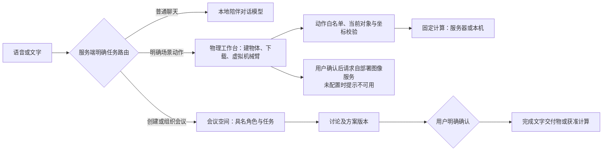
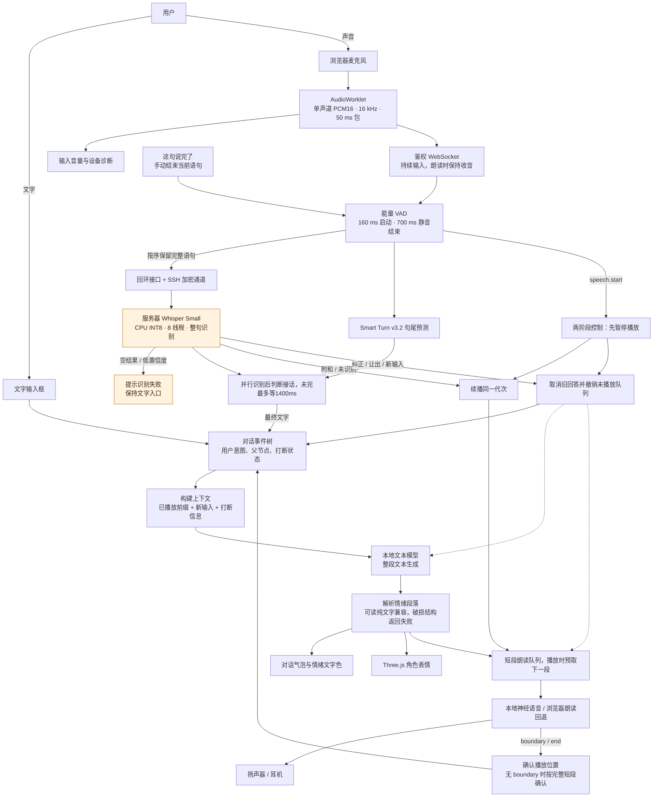
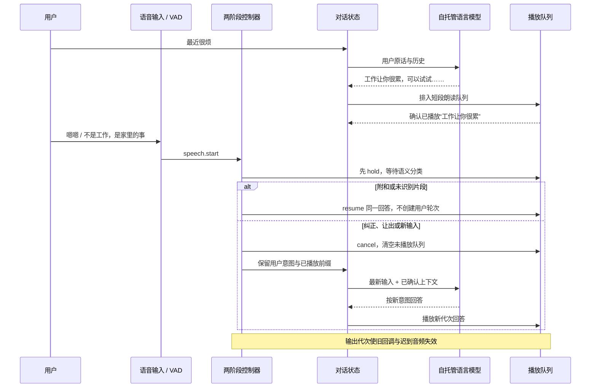
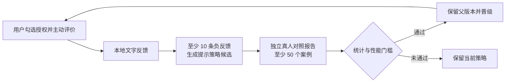
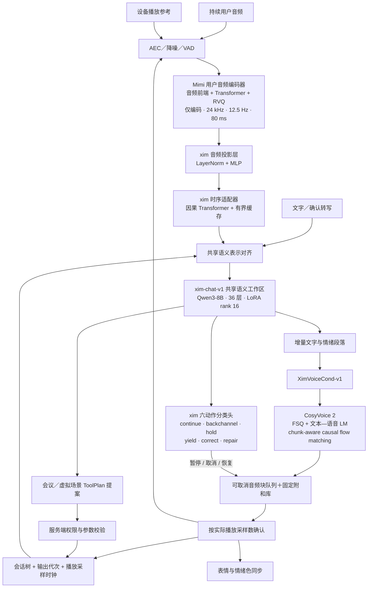
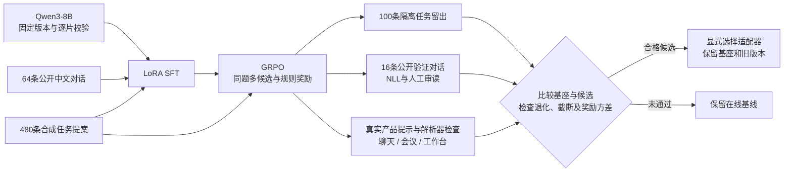

# Xim Duplex 当前模型与对话流程

更新时间：2026-11-24 · 代码版本：v0.10.0

现行产品不调用第三方云 API。当前主对话链路是 Xim 持续收音 → 自部署 Whisper＋Smart Turn → 两阶段插话控制与有限交互状态 → 明确任务路由或自托管语言模型 → 本地神经语音，服务不可用时回退设备朗读。讲话开始先 hold，附和或未识别可 resume，纠正／让出／新输入才 cancel。实际启用状态与组件实测见[验证记录](VALIDATION.md)。

主对话现在可以接收明确语音口令创建虚拟会议，或把场景动作交给物理工作台；普通聊天、能力提问和否定句不触发任务。工作台与会议空间使用自托管语言模型处理结构化任务，由 Xim 检查方案、确认、对象、坐标和执行状态。完整模型参数、时序与安全边界见 **[语音任务全链路模型细节](VOICE_TASK_PIPELINE.md)**，操作方式见 [使用指南](WORKBENCH_AND_MEETING.md)。

主对话可配置独立文本和声音服务，图像生成改为自部署服务接口；见[部署说明](SELF_HOSTED_ROADMAP.md)。本机已连接服务器的 Nano 语音，图像模型尚未部署。自主研发与训练边界见[技术路线](MODEL_STRATEGY.md)。

**状态：可插话的级联原型。Windows 听写在真人测试中失败后，已切换为经 SSH 连接的 Whisper Small；三条合成语音与静音检查通过，用户已确认能识别真实讲话。复杂重叠对话仍待验证。** 下图描述当前这台机器配置的实际链路；目标架构单独列出。

## 1. 当前运行链路

当前机器通过私有配置启用服务器 Whisper Small；模型 revision 为 `536b0662742c02347bc0e980a01041f333bce120`，模型文件已校验 SHA-256。服务端和本机转发端都只监听回环地址，音频经 SSH 传输，不保存原始录音。Windows 听写仍是未配置远程服务时的兼容路径。本机被拦截的 NumPy 未启用。模型替换改善识别入口，但尚未提供流式转写或原生双音频流生成。

## 2. 插话后的上下文如何续接

这是应用层的对话事件树和规则分类，不是原生端到端双工模型，也不能将用户对话插入模型内部隐藏推理。播放确认是浏览器事件估计，不能精确证明用户听到了哪一个音素。当前分类依赖最终转写，开放扬声器、背景对话、口音和复杂重叠语音仍需独立实测。

## 3. 当前递归改进范围

目前没有达到策略晋级所需的真人数据。独立的 xim-chat-v1 文字多任务后训练已完成首轮试验，见第 5 节；语音模型自进化仍未完成。服务端现已把本地 active 策略文字实际传入聊天请求，策略记录不等于权重更新。

## 4. 创业目标：跨模态融合（尚未训练或集成）

目标架构采用新的语音理解与合成组件，现有级联 Demo 仅作为工程对照；目标与当前实现不得混写。Mimi、xim-chat-v1 与 CosyVoice 2 通过xim 适配层共享语义表示，不把权重直接相加，也不把简单服务串联称为已融合模型。

候选、证据与边界：

- [Mimi／Moshi](https://github.com/kyutai-labs/moshi)：目标链路只采用 Mimi 用户音频编码器；上游说明为全流式、80 ms 帧级表示。2026-11-23 本机 Windows CPU 独立微基准为 n=10、3.84 秒合成音频编码 P50 3793.193 ms／P95 4765.936 ms；不证明实时、中文语义、重建音质或 LiveBridge 集成。
- **xim 适配层**：音频投影、因果时序适配器、轮次行为头和 XimVoiceCond-v1 都是待训练模块；维度与接口必须按实际模型张量契约实现，不虚构融合参数或检查点。
- [CosyVoice 2](https://github.com/FunAudioLLM/CosyVoice)：FSQ、文本—语音 LM 与 chunk-aware causal flow matching 的合成候选；增量文本、可听首音、自然度、取消与并发均未在 Xim 实测。
- [SpeechTokenizer（ICLR 2024）](https://proceedings.iclr.cc/paper_files/paper/2024/hash/86d1ab582afb247ccaa84bec4a7e24f7-Abstract-Conference.html)：仅作 RVQ 语义／声学解耦对照，不作为原生流式能力证据。
- [Moshi](https://github.com/kyutai-labs/moshi)：仅作独立原生双音频流研究参考，中文效果、许可与算力需独立评估。
- [MOVA 论文](https://arxiv.org/html/2602.08794v2)：同步音视频生成架构，可借鉴时间对齐与跨模态桥接，不是现成的语音对话模型。本项目未加载其权重。

详细融合结构、接口与分阶段训练见 **[融合模型设计](FUSION_ARCHITECTURE.md)**；双工状态与验收定义见 [全双工架构说明](DUPLEX_ARCHITECTURE.md)；逐次结果与限制见 [验证记录](VALIDATION.md) 和 [组件实测](evaluations/2026-11-23/README.md)。

## 5. xim-chat-v1 离线多任务后训练

产品模型名称为 **xim-chat-v1**；基座标明 Qwen3-8B 与固定修订。首轮 SFT 136 步、GRPO 120 步及离线评测均完成。v0.9.4 采用 SFT 检查点，100 条任务完整正确率 94% → 100%；GRPO 未证明额外收益。真实产品开发回归在修复选择别名后通过 11/11，仍需真人语音与更广泛场景验收。

训练任务的 JSON 提案和主聊天的情绪段落是不同接口；任务分数不能替代产品兼容性检查。GRPO 的可验证任务奖励不是人类情感偏好，也没有训练语音生成或物理世界模型。完整来源和状态见 [xim-chat-v1 模型卡](XIM_CHAT_V1_MODEL_CARD.md)。
