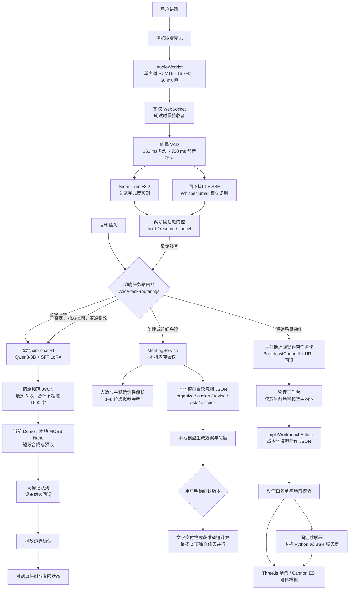
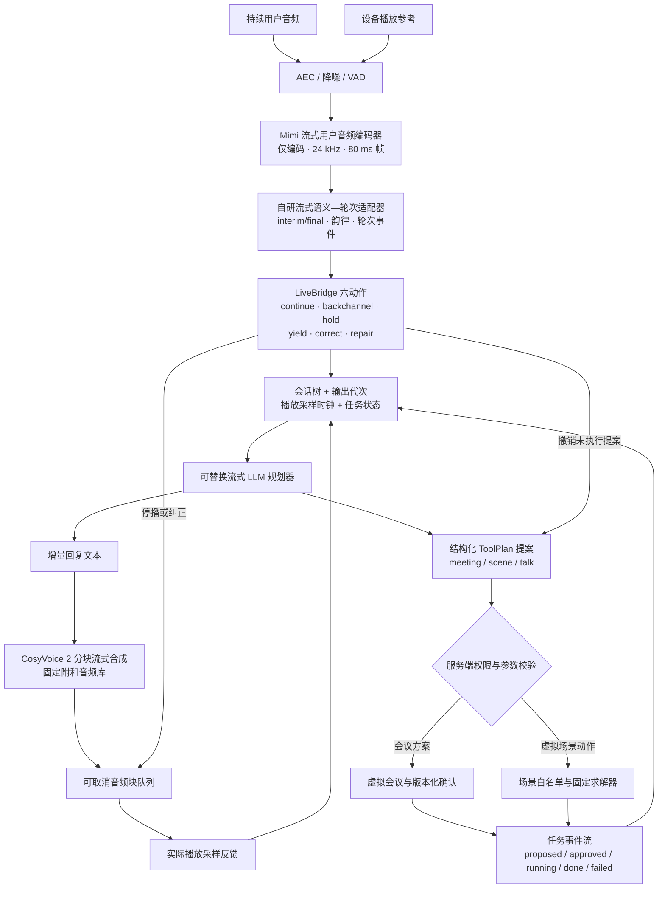

# Xim 语音对话、会议与物理场景：全链路模型细节

更新时间：2026-11-24

本文把**当前 GitHub 可运行链路**与 **Xim LiveBridge 创业目标链路**分开描述。语音既能进入普通陪伴对话，也能在主对话中发起虚拟会议或向物理工作台提交受约束的场景指令。这里的“物理场景”是浏览器中的三维刚体与虚拟机械臂，不是真实机器人。

## 1. 当前实现总图

关键边界：

- 主对话只路由**明确任务口令**；“你能创建会议吗”“不要添加方块”“陪我聊聊物理场景”不会执行。
- 模型返回的 `tool_calls`、任意命令和未列出的动作不会被主聊天接受。任务类型由服务端路由器和各模块白名单决定。
- 创建的是虚拟会议，不邀请现实人员；会议任务先形成方案，只有“确认执行 人名／全部”或等效按钮才执行。
- 工作台只接受固定场景动作和固定计算任务，不执行模型生成的 shell、Python、URL 或真实硬件命令。

## 2. 语音理解与轮次控制

| 层级 | 当前组件与参数 | 输出 | 尚未证明的能力 |
|---|---|---|---|
| 采集 | AudioWorklet；单声道 PCM16；16 kHz；50 ms 包 | 连续音频帧 | 开放扬声器下的可靠 AEC |
| 活动检测 | 能量 VAD；160 ms 启动；700 ms 静音结束 | 语句边界 | 复杂噪声和多人重叠语音的稳健切分 |
| 句尾预测 | Smart Turn v3.2 | 是否可能说完 | 所有口音、背景对话与韵律条件下的通用判断 |
| 识别 | Whisper Small；固定 revision `536b0662742c02347bc0e980a01041f333bce120`；整句识别 | 最终文字 | 流式字词时间戳、原生语义理解 |
| 接话控制 | `hold → resume／cancel`；附和可续播，纠正、让出或新输入取消旧答 | 播放控制与新一轮输入 | 端到端神经双工策略 |

已测组件值不能拼成端到端延迟：Whisper 固定音频完整转写 P50 894.005 ms（n=5），Smart Turn 服务端处理 P50 32.630 ms（n=10）。这些是不同模块的小样本测量，不包含真人可听首音、网络总等待、AEC 或重叠语音成功率。

## 3. 对话生成与语音输出

### 3.1 当前对话模型

- 服务模型名：`xim-chat-v1`；基座为 Qwen3-8B。
- 当前线上选择 **SFT LoRA 检查点，训练 136 步**。另有 GRPO 120 步试验，但奖励组无方差，未证明额外收益，不作为当前效果声明。
- 主聊天请求：`temperature = 0.65`、`max_tokens = 320`、非流式。
- 输出契约：`segments[{text, emotion}]`；情绪仅允许 `joy／warm／calm／curious／support／celebrate`。
- 最多保留 6 段，合计不超过 1600 字；结构损坏、空输出、截断或过滤输出不展示为有效回复。
- 主聊天模型仍不能自行授予工具权限。`localChat` 会丢弃模型给出的任务和工具字段，明确任务由服务端确定性路由进入受限模块。

### 3.2 当前语音合成

主对话当前 Demo 使用本地 MOSS Nano 短段合成、下一段预取和设备朗读回退。它是**现行级联基线**，不是 LiveBridge 新链路组件。短段播放可取消，但已经开始的神经合成不等于可立即中止；浏览器播放边界只是已播放位置的工程估计，不是音素级听觉证明。

会议页与工作台页的结果提示使用浏览器 `speechSynthesis`。它们与主对话的神经 TTS 是不同输出路径，不能混写为同一个流式语音模型。

## 4. 语音创建会议：模型与执行细节

用户可在主对话说：

> 组织三个人开会，主题是产品演示。

处理顺序：

1. Whisper 输出最终转写。
2. `routeVoiceTask` 识别明确会议意图。
3. `MeetingService.create()` 在本机内存创建房间；人数和主题由确定性解析优先处理。
4. 主对话返回可朗读的创建结果和会议入口；会议页通过 `room` ID 获取同一场会议快照，不会重复创建。
5. 后续派活、修改、提问和讨论使用本地模型结构化 JSON；参会者 ID 必须来自当前房间。
6. 方案带修订号。修改后旧确认失效；只有明确批准当前版本才执行。
7. 执行结果可以包含文字交付物，或调用已接入的固定机械臂轨迹计算。

| 调用 | 当前 `max_tokens` | 作用 |
|---|---:|---|
| 主对话 | 320 | 陪伴回复，不处理任意工具调用 |
| 会议意图路由 | 550 | organize／assign／revise／ask／discuss／talk |
| 方案生成或修改 | 600 | 标题、2–4 个步骤、必要问题、可选固定轨迹操作 |
| 单个参会者讨论 | 450 | 一条简短意见或问题 |
| 已批准任务执行 | 1900 | 摘要、具体交付物与限制 |

会议模型只使用提供的房间材料，不声称搜索外部资料、安排真实日历或操作他人系统。服务重启后房间不保留；每次群体讨论最多三位参会者，执行最多两项独立任务并行。

## 5. 语音控制物理场景：模型与安全边界

用户可在主对话或工作台说：

> 添加一个红色方块。
>
> 让机械臂抓起小砖。
>
> 计算当前场景的下落结果。

### 5.1 主对话到工作台

- 主对话返回 `task = {kind: "workbench", id, input, href}`，不把模型自由文本直接当成场景动作。
- 工作台已打开时，同源 `BroadcastChannel` 传递原始口令；未打开时，任务链接携带一次性任务 ID 和口令。
- 工作台读取**自己当前的**对象列表、选中对象和最近历史，再调用 `/api/workbench/intent`。
- 任务 ID 用于页面去重；具体执行结果以工作台日志和三维场景为准，主对话不虚构“已经移动成功”。

### 5.2 动作理解与校验

简单添加口令可由 `simpleWorkbenchAction` 直接解析；其他口令进入本地模型，`max_tokens = 480`，只返回一个动作 JSON。

允许动作：

- `add`：方块、球体、圆柱；颜色仅 `amber／jade／coral／ivory／blue`。
- `move／paint`：目标必须是当前场景中合法的对象 ID；坐标必须为三轴有限数值且绝对值不超过 10。
- `pick／place／release／trajectory`：虚拟机械臂动作或轨迹。
- `physics`：固定下落估算。
- `download`：仅场景 JSON、Blender 脚本、GLTF 或计算报告。
- `image`：只生成图片提案，前端另行确认；未配置服务时明确不可用。

场景输入最多保留 32 个合法对象和 8 条历史。`selected` 只有对应当前选中对象时才可解析；未知 ID、越界坐标、额外 `command` 字段和未列出效果都会被拒绝或转成澄清对话。

### 5.3 场景与计算不是同一模型

- **Three.js**：显示物体、机械臂和交互状态。
- **Cannon ES**：浏览器内重力、接触和碰撞模拟。
- **固定臂求解器**：三关节逆运动学与 37 点平滑轨迹；检查末端采样点的保守包围盒阻挡。
- **下落估算**：忽略空气阻力，计算撞地时间和速度；与浏览器接触模拟分别标注。
- **本地语言模型**：把口令映射为白名单动作，不负责数值物理积分，也不能直接改求解器代码。

当前没有实体机械臂驱动、安全 PLC、真实碰撞避免、连杆完整碰撞检查或自动绕障，不能用于现实机器人安全控制。

## 6. LiveBridge 创业目标链路（未集成）

目标架构用流式理解、决策、生成和工具状态取代当前整句级联，但不把目标写成已有效果。

### 6.1 目标模型分工

- **Mimi**：只负责用户音频编码，不承担中文语义、会议规划或物理控制。
- **语义—轮次适配器**：拟把音频表示、识别中间结果与韵律映射为语义事件和轮次事件；目前尚未训练或集成。
- **LiveBridge**：在语音输出期间决定继续、附和、暂缓、让出、纠正和修复；六动作是交互控制，不是会议或机械臂动作。
- **流式 LLM 规划器**：生成增量回复或结构化 `ToolPlan` 提案；工具权限仍在模型之外。
- **会议与场景校验器**：复用当前受限 API 的对象、坐标、版本和确认约束，再增加任务代次与取消状态。
- **CosyVoice 2**：候选分块流式合成器；未部署、未测可听首音、自然度、取消或并发。

### 6.2 语音打断与工具状态

目标状态下，用户纠正应立即影响未播放音频和未执行任务提案；已经获准的数值计算不能假装“未发生”，应以任务事件返回完成、失败或不可撤销状态。真实硬件若未来接入，必须另有急停、权限、速度／空间限制和安全认证，不能仅依赖 LLM 取消。

Mimi 目前只有本机独立编码微基准：3.84 秒合成音频、48×80 ms 编码步、n=10，P50 3793.193 ms、P95 4765.936 ms；这不是服务器、实时、语义、重建音质或 LiveBridge 集成结果。CosyVoice 2 和上述 ToolPlan 流式闭环均为 **NOT_TESTED**。

## 7. 数据与部署边界

- 文本、图像、语音和计算 worker 只接受本机回环地址；远程识别或计算通过 SSH 转发。
- 主服务默认只监听回环地址；API 使用每次启动生成的令牌，静态页面使用同源连接。
- 音频不落盘；会议只保存在当前服务内存；物理场景保存在当前浏览器。
- 会议发言是虚拟角色生成内容；场景结果是模拟与固定数值求解，不是现实世界状态。
- 当前可运行证据与组件测量见 [VALIDATION.md](VALIDATION.md) 和 [组件实测](evaluations/2026-11-23/README.md)。
