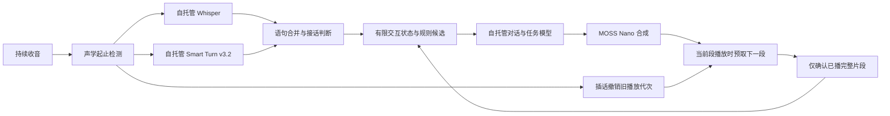

# Xim 的交互预测与世界模型路线

更新：2026-11-16，v0.9.3。

## 已接入的部分

当前不是已训练的神经世界模型。MOSS Nano 是发声基座；Whisper 负责转写；Qwen 负责对话。新增 Smart Turn v3.2 判断用户是否说完，交互状态基线记录有限观察，播放队列预取下一小段。各组件协作，不把不同结构的权重直接相加。

- `turn-completion.mjs`：模型与 ASR 并行。预测未说完时最多额外等 1400 ms，继续说话会撤销旧计时；模型失败或 800 ms 超时回到既有 VAD。预测不是用户意图、执行授权或绝对事实。
- `interaction-state.mjs`：只保留最近用户原话、确认听到的前缀、打断类别、回应/让话/修正/澄清候选。候选结果是规则假设；情绪、场景、任务执行结果没有观察就标未知。一次回复仍只调用一次语言模型，不额外串行调用“世界模型 LLM”。
- `public/speech-queue.js`：最多预取下一段；取消后迟到结果不会播放或记作已听到。尚不支持中止已进入 MOSS CPU 内部的合成。

## 为什么不直接接一个视频世界模型

[Smart Turn](https://github.com/pipecat-ai/smart-turn) 使用 Whisper Tiny 编码器和浅分类头，直接从语音判断话轮结束；官方支持中文，适合当前接话问题。[模型卡](https://huggingface.co/pipecat-ai/smart-turn-v3)标注 BSD-2-Clause、约 8M 参数，它不是语音识别器或世界模型。

[V-JEPA 2/2.1](https://github.com/facebookresearch/vjepa2)主要学习视频表示，动作条件版本 V-JEPA 2-AC 才可用于相应物理规划。它没有替代中文对话理解的能力证据；将其放进每轮语音关键路径会增加工作量与等待。[DreamerV3](https://github.com/danijar/dreamerv3)从环境交互学习未来状态和奖励，需要自有轨迹、奖励和策略训练，不能作为现成中文聊天权重加载。二者应先在物理工作台后台研究。

## 要训练的世界模型：尚未实现

拟采用动作条件的交互动态模型：

`z_t = Encoder(音频特征、已确认文本、播放位置、工具观察)`

`z_(t+1), 话权, 更正风险, 任务状态 = Dynamics(z_t, 候选动作)`

动作先限于等待、简短回应、让话、澄清、提议任务。使用真实、获授权且时间对齐的交互轨迹训练下一状态预测；物理模拟轨迹可训练物理动态，但不能替代真人话轮偏好。新模型的预测需与工具真实结果分开保存；预测成功不等于任务已执行。

语音控制头可借鉴 [VAP](https://github.com/ErikEkstedt/VoiceActivityProjection) 的未来语音活动预测，必须评估中文与双方独立音轨条件。当前既没有训练这一网络，也没有录制/保存用户音频用于训练。

## 已验证部署与边界

Smart Turn 固定 revision `f766f81d3cfdf7737ac64aad813d91bbfd56bf93`，CPU ONNX 文件 8,679,182 bytes，SHA-256 `2bb026316b14a660486a75b1733cd3fbab8c2fd0314dc9af7be49f8cca967e4f`。源代码固定 `4e12f2bbef04e47c348836f57100885f6973a5ae`；完整许可证在 `scripts/SMART_TURN_LICENSE`。模型仅存私有数据目录，不进 Git。

推理在用户服务器 CPU；本机通过 SSH 回环转发 18802 连接远端 18796。同一开发音频重复 5 次：服务处理 72.81–79.94 ms、往返 137.09–169.16 ms；这是接口与延迟检查，不是准确率或 P95。浏览器合成麦克风走真实 Whisper、Qwen 和 MOSS 返回音频；真实重叠讲话、附和识别与独立用户偏好仍待测。

安装：Python 3.11/3.12 独立环境，按 `requirements-turn.txt` 安装，先运行 `scripts/install_turn_model.py`，再用 `scripts/turn_worker.py --model <ONNX路径> --port 18796`。配置 `private/turn-model.json` 的 `url` 或环境变量 `XIM_TURN_URL`。空环境变量可禁用，模型失败自动保留 VAD 路径。Windows 应用控制不允许本机原生依赖，因此本机没有绕过策略加载，部署选用已授权 Linux。

验收必须分开测：句尾到首音、段间静默、过早接话、漏接、附和误打断、纠正后的任务成功率、自然度盲评。当前仍有 700 ms VAD 静音窗口、整句 ASR、完整文本生成和完整短段 TTS；不能称原生全双工或已达最优效果。
